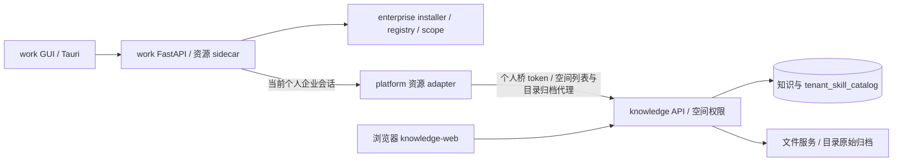
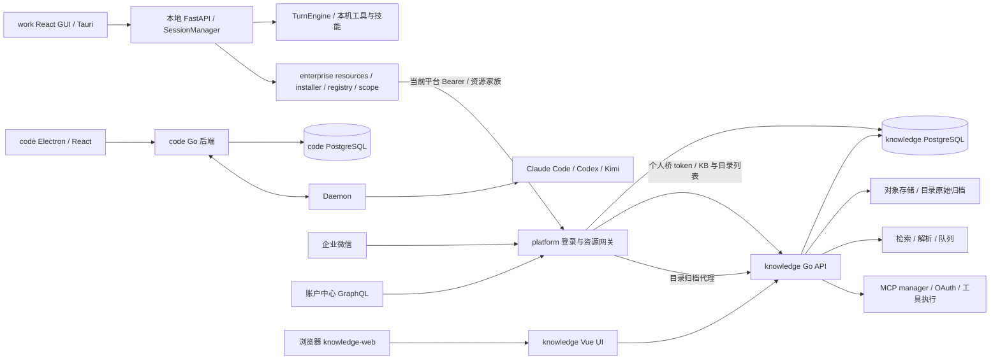

# work-opc 与企业资源系统架构基线

## v1.3 反向对账说明（2026-10-23）

本次在 WORK-RESOURCES-001 Loop 1 实施与自动化验证完成后、AI Review 前，按最终实现反向对账回写（对账人：Kimi，实施工程师；依据三仓隔离 worktree 未提交差异，固定基线见 [repositories.json](../loops/demands/WORK-RESOURCES-001/repositories.json)）。**变更原因：按最终实现反向对账；影响：本基线反映 Loop 1 三仓交付事实。**改动只限本文件与需求目录 `repositories/overview-change-surface.md`，不改写 v1.0～v1.2 已确认条款与历史快照。

- **已交付（已实现、已通过本仓自动化测试）：**work 的 enterprise resources 小模块（`resources.py`/`installer.py`/`registry.py`/`scope.py`）、sidecar 7 端点与 WS 范围扩展、GUI 资源视图；platform 的资源 adapter（4 路由）、scope 受限知识读取、旧发布协调删除；knowledge 的目录原始归档服务（Viewer+ 路由）、release 全链路删除、网页详情定位与登录回跳适配。v1.2 记录的缺口（work 无知识范围选择、platform 无客户端目录浏览、knowledge 无目录直接下载）已闭合。
- **已实现，未上线：**三仓改动均未提交、未构建镜像、未在测试服务器部署；三仓联调、真实浏览器/DMG 手测、60 秒撤权真实计时（TASK-025/027）未执行。部署新构建前，线上仍运行旧二进制，旧技能 release 路由对旧客户端仍旧可见。
- **数据清理：**knowledge 迁移 000133（PG）/000047（SQLite）、platform 迁移 000017 与两仓备份恢复工具已实现并通过双引擎/真实 PG16 验证；生产环境的实际清理仍按 BND-011 前置条件（旧写入停止 + 备份恢复演练）在获授权环境执行，本文件不宣称生产数据已被清理。

## v1.2 当前审查说明（2026-10-22）

本次在 WORK-RESOURCES-001 Architecture 阶段复核，状态改为 draft；v1.0 的用户确认与 v1.1 对账记录保留为历史。下文旧版的“当前”“尚待建设”“尚未部署”只反映 2026-10-20/21 当时快照，不能覆盖以下新核对的源码事实。本次不重新判断历史部署是否完成。

- **已验证源码：**work 的 enterprise/auth.py、tools.py、skills.py 与 server/manager.py 已有企业登录、知识工具、release 归档安装与上下文门控。旧图注“尚未实现 work/code 企业资源网关调用”已过时；work → platform → knowledge 是现存源码调用，端到端可用性需运行证据。
- **已验证源码：**platform 的自有状态库、显式迁移及知识/技能/MCP 适配已存在；旧文“待建设”及自动 cron 描述为历史快照，当前事实见 main.go、pkg/handler/integration.go、knowledge.go、skills.go。
- **已验证缺口：**work 尚缺知识范围选择和消息级执行约束；平台尚缺客户端知识库浏览接口；旧技能链路依赖 published release 并自动同步安装。knowledge tenant_skill_catalog 已保存 BundleRef/BundleSHA256，可读取权威原始归档；本轮目录直接下载接口尚未实现。
- **安装限制：**旧 installer 先删除原目录再 move，不能由 atomic 注释证明失败保留旧版本；安装根按 tenant/publish_id，也不足以证明同租户不同主体的文件隔离。
- **已确认新决定：**上传按钮打开 https://shtokendance.benlai.com；work 新链路移除技能 release 发布依赖，用户允许删除上一 Loop 旧 release 并排除 code-opc 兼容。清理尚未执行。
- **运行证据范围：**本轮仅对 HTTPS 首页做无凭据 HEAD，返回 200 HTML；未验证网页登录、上传、镜像来源、桌面登录或业务闭环。旧容器和镜像快照不是本轮部署证明。

本轮候选设计见 [WORK-RESOURCES-001 architecture](../loops/demands/WORK-RESOURCES-001/loop-1/architecture.md)，状态 draft；三仓固定基线见该需求 [repositories.json](../loops/demands/WORK-RESOURCES-001/repositories.json)。旧四仓清单仅适用于旧需求。候选的新列表、scope、catalog 下载和清理方案尚未实现，不能当作当前能力。

图表达截至 2026-10-23 工作树已实现的调用边界：本轮新增 work→platform 资源家族与 platform→knowledge 目录归档代理；旧 skills release 家族已从工作树删除（部署新构建前线上仍旧）。以下旧版原文作为历史保留，与上述审查冲突时以注明日期的新事实为准。

本文件记录当前代码与运行边界，供长期维护。首次在 OPC-INTEGRATION-001 的 Architecture 阶段建立（v1.0，2026-10-20 确认）；v1.1 于 2026-10-21 按 Loop 1 最终实现代码对账回写（对账人：Kimi；依据四仓工作区最终状态，尚未提交部署——部署后需再按运行事实校准）。目标方案位于 [本轮 architecture.md](../archive/demands/OPC-INTEGRATION-001/loop-1/architecture.md)；其中已实现的部分在本文件"集成实现事实"节记为当前事实，未部署部分保持目标方案属性。

四仓基线与分支唯一权威为 [repositories.json](../loops/demands/OPC-INTEGRATION-001/repositories.json)。2026-10-20 用户明确确认基线一致并要求停止继续核查，后续设计依此推进。下面保留此前已取得的只读事实，不再调查版本一致性。

## 当前系统与依赖

work 企业资源网关调用已在本轮工作树实现（resources 边，未部署）；code 仍无企业资源网关调用。platform 网关仍直接写 knowledge 身份/成员/token 数据，客户端当前仍保留各自登录与执行结构。

## 模块、存储和边界

| 系统 | 已验证结构 | 数据/安全边界 | 证据 |
| --- | --- | --- | --- |
| work-opc | Python >=3.10、FastAPI；React/TypeScript/Vite GUI；Tauri 2；TurnEngine；WORK-RESOURCES-001 新增 `coworker/enterprise/{resources,installer,registry,scope}.py`、sidecar 资源端点与 GUI 资源视图（已实现，未部署） | ConversationStore 为 SQLite；SecretStore 默认 secrets.json；本地 HTTP/WS 有 sidecar token 和来源处理；会话 JSONL 新增 `_resources` sidecar；授权缓存 ≤30s 失败关闭 | `pyproject.toml`；`surfaces/gui/package.json`；`surfaces/gui/src-tauri/Cargo.toml`；`coworker/conversations.py:76`；`coworker/secrets.py:229`；`coworker/server/app.py:224`；`coworker/enterprise/resources.py`；`coworker/server/app.py:2056` |
| code-opc | Go/Chi/sqlc、PostgreSQL、WS、Daemon；React shared core/views/ui；Electron 桌面 | JWT/PAT/task token 是不同入口；workspace membership 授权；任务运行与后端分离 | `server/go.mod`；`server/cmd/server/router.go`；`server/internal/middleware/auth.go`；`AGENTS.md` |
| platform-opc | Go/Gin/GORM、企微认证、账户中心 GraphQL、组织同步、管理页面；WORK-RESOURCES-001 新增资源 adapter（`pkg/handler/resources.go`，4 路由）与 scope 受限读取，旧 skills 发布协调及 `skill_publish_jobs` 已从工作树删除（未部署） | 直接使用 knowledge 数据库和 JWT 约定；本地映射表启动 AutoMigrate；状态库迁移至 000017（drop skill_publish_jobs，含备份恢复工具）；不持有 Admin 身份代用户取归档 | `main.go`；`pkg/storage/storage.go:21`；`pkg/auth/service.go:29`；`pkg/handler/resources.go`；`migrations/000017_drop_skill_publish_jobs.up.sql` |
| knowledge-opc | Go/Gin、Vue/TS、RAG、空间 RBAC、技能 catalog、MCP manager/个人 OAuth；WORK-RESOURCES-001 新增 Viewer+ 目录原始归档路由，skill_release handler/service/repository/types/DI 已从工作树删除（未部署） | 数据库与文件服务为云资源权威；个人 JWT 读 token 撤销及用户状态，资源权限另行检查；迁移 000133（PG）/000047（SQLite）只 drop skill_release 及专属索引，历史迁移不改 | `go.mod`；`frontend/package.json`；`internal/application/service/user.go:1285`；`internal/router/routes_knowledge.go`；`internal/handler/skill_catalog_archive.go`；`migrations/versioned/000133_drop_skill_release.up.sql` |

上表其他仓路径均相对对应仓库根，不指向开发机工作树路径。集成治理只在 work 主仓维护；参与仓原有治理入口不被本轮另开 Loop 或改写。

## 当前关键链路

- **work 引擎注入：**`coworker/agent.py:224` 的 `build_engine` 接收 `extra_tools`、`extra_skill_dirs` 与 `skill_filter`。`coworker/server/manager.py` 组织会话、MCP、provider 和秘密存储。现有注入能力不自动提供企业账号/空间隔离。
- **work 企业资源链路（本轮新增，已实现未部署）：**sidecar 7 端点（`coworker/server/app.py:2056-2213`，列表/单项/安装/启停/卸载/操作查询）；WS `user_message` 接收 `knowledge_scope`/`skill_ref` 全校验后生成 `turn_id` 与服务端标签，拒绝带 INT-105 码并保留草稿（`app.py:3741-3904`）；`engine.run` 新增 `resources` 参数，`_resources` sidecar 在出站前剥离、不进 provider 标准消息。授权复核缓存 `GRANT_TTL_SECONDS=30.0`，缺失/超时/失败按不可用处理（`coworker/enterprise/resources.py`）。旧 publish_id 安装与自动同步已删（`enterprise/skills.py`），旧目录识别为 `legacy_requires_reinstall`（`enterprise/installer.py`）。
- **platform 资源代理（本轮新增，已实现未部署）：**`pkg/handler/resources.go` 四路由按当前 entitlement 逐空间用个人桥 token 查 knowledge，NFC 大小写无关名称匹配，返回 `{items,total,offset,limit,complete,failures}`；部分空间失败 `complete=false` 只含原授权空间标识；归档代理收齐后三向哈希校验（预期/上游 X-SHA256/实际字节），独立下载预算 120s 总/15s 无进度。`GetKnowledge` 在 `tenant` 与 `knowledge_base_id` 成对时进入 scope 模式：只用指定空间/库、权威归属核验后才输出正文，错配 403 `SCOPE_MISMATCH` 且不泄露正文（`pkg/handler/knowledge.go:367-386`）。
- **knowledge 目录归档（本轮新增，已实现未部署）：**`GET /api/v1/skills/catalog/:id/archive`（Viewer+，`internal/router/routes_agent.go:93`），`expected_sha256` 必填并规范化，服务端按 tenant+catalog_id 严格查目录并核验 expected/current/actual 三 SHA，返回原始字节与 X-SHA256，不创建发布记录、不返回存储内部路径（`internal/application/service/tenant_skill_catalog_archive.go`）。
- **code 登录与执行：**`server/internal/handler/auth.go:159` 签发本地会话；`server/internal/middleware/auth.go` 处理 JWT、PAT、任务 token；`server/internal/handler/daemon.go` 领取任务并组合 MCP/技能。code 库和任务/Git 不属于 knowledge 的数据模型。
- **platform 认证：**`pkg/handler/handler.go:109` 企微回调后查询账户中心、供给用户，并通过 `pkg/auth/service.go` 生成 knowledge token。`/oidc/token` 返回随机字符串、`/oidc/userinfo` 返回固定用户，不能视作已完成的 OIDC provider。
- **platform 同步：**`main.go:53` 启动自动全量同步，另有 cron；`pkg/syncer/syncer.go:231` 缓存未命中亦可调用 SyncAll。账户中心部门查询只取 first:2000；现有人员同步跳过停用用户，已有成员保持角色，因此尚不构成完整撤权闭环。
- **knowledge 个人授权：**`ValidateToken` 查询 token 是否撤销并重取用户状态，`internal/middleware/auth.go` 解析当前 tenant；KB/文档路由继续检查资源访问。原文件下载比预览权限更高，不能在新代理中合并。
- **knowledge 技能：**`internal/router/routes_agent.go` 开放 Viewer catalog 元数据、Admin 文件预览；本轮新增 Viewer+ 目录原始归档下载（见上）。`internal/application/service/tenant_skill_files.go:194` 经文件服务读取完整归档，仍为非公开内部路径。catalog 更新存在归档替换/保留处理，版本以 `bundle_sha256` 固定。旧 release 发布家族（publish/releases 路由、handler/service/repository/types/DI、DeleteCatalog 账本检查）已从工作树删除，部署前线上仍旧。
- **knowledge MCP：**`internal/router/routes_infra.go:144` 提供服务发现、工具策略与个人 OAuth；`internal/agent/tools/mcp_tool.go:146` 实施工具策略和依赖执行上下文的审批；`internal/mcp/manager.go` 为 OAuth 按 principal 建连接。单独暴露底层 CallTool 不能等同于复用整套安全语义。
- **code 受管缺口：**MCP 绑定加载/解析失败可回退原配置；`ResolveTaskSkillBundles` 对普通技能允许返回变更后的包；缓存主要按 workspace/ref 组织。企业隔离、固定归档、失败关闭需另补。
- **本机许可：**Claude adapter 默认 `bypassPermissions`；Kimi ACP 已有自动许可路径。企业本机审批不能由云端角色或 tool approval 自动替代。

## 集成实现事实（2026-10-21 对账回写，工作区代码状态，未部署）

以下为 OPC-INTEGRATION-001 Loop 1 已实施并经验证的代码事实（逐仓详见 demand 目录 `repositories/<repoId>/implementation.md` 与 `verification.md`）：

- **platform-opc（weknora-gateway）**：新增自有状态库（`statedb`，迁移 000001~000015：audit_events/identity_links/auth_transactions/sessions/runtime_grants/workspace_links/managed_entitlements/sync_runs/sync_steps/skill_publish_jobs/authz_epochs）与显式迁移框架；管理面 JWT 认证 + CSRF 白名单 + 审计（`PLATFORM_ADMIN_KEY`）；客户端认证组 `/integration/v1/auth/*`（PKCE、一次性码 120s、refresh 族轮换复用检测、`PLATFORM_AUTH_KEY`）；服务间租约/授权版本/撤权（`/integration/v1/internal/*`，authz_epochs 每主体版本纪元）；手动同步服务（`/integration/v1/admin/sync/*`，状态机 + 持久化锁 + 逐步幂等账本；启动/cron/缓存补偿全量触发已删除，`/wecom/sync` 410）；账户中心客户端游标分页 + aggregate 对账；knowledge 兼容桥（`pkg/kbridge`，`PLATFORM_BRIDGE_KEY`，签发前置六条件，auth_tokens 插入/按用户删除）；知识适配、技能发布协调/下载转发、MCP 精确调用转发（user 与 task 双 actor，`aud=platform-integration`）；企微 TLS 校验恢复、事件回调验签、AES key 缺失显式失败。
- **knowledge-opc（WeKnora fork）**：EXT-001（迁移 000129 `skill_release`；发布/查询/下载/下架五路由，manifest `opc-client.json` 校验，payload digest 语义）；EXT-002（迁移 000130/000131 `mcp_invocations`/`mcp_invocation_decisions`；五路由全状态机，双身份调用上下文，请求级审批绑定，Ask 不静默跳过）；均限定范围内，未动检索/Agent 引擎/stdio 限制。
- **work-opc（OpenWorker）**：`coworker/enterprise/`（认证服务、受管技能目录、企业工具 knowledge_search/read 与 mcp_invoke、审批桥接 Inbox）；Rust Keychain 命令（keyring 3）；sidecar 六端点（回调 tokenless）；GUI 企业登录四态状态机。Tauri Cargo.lock 待 Rust 环境更新（backlog）。
- **code-opc（Multica）**：迁移 585~589（user 企业四列、enterprise_workspace_link + CONCURRENTLY 唯一索引、PAT 企业快照、link tenant 列）；federation exchange 与 `ent_sid/ent_ver` 纪元（JWT/PAT/WS，Redis ≤30s 缓存 + Invalidate 接口）；Daemon 租约检查点与 MCP failed-closed/empty 语义、旧 Daemon 拒绝；企业技能 resolver（五元组缓存 pin）；三 CLI 企业受管参数矩阵（Claude 去 bypass/Codex 显式 approval+reject/Kimi ACP 只 reject）；Electron safeStorage 保险库 + 回环回调 + daemon 企业门控；claim 发放 enterprise SkillRefs。
- **跨仓约定**：调用上下文 `sub`=knowledge 用户 id、`user`=immutable_subject、`aud=platform-integration`（knowledge 侧配置 `WEKNORA_INTEGRATION_CONTEXT_AUDIENCE` 需同值）；技能 pin = `sha256:<manifest payload digest>`，整包字节哈希走 X-SHA256/bundle_sha256。
- **对账差量（2026-10-21，审查驱动）**：`mcp_invocations` 在 DATA-130a 字段清单外新增 `risk` 列（迁移 000132；崩溃清扫按风险分窗需要它）；规格 BND-140/150 措辞澄清（payload digest / sub-user claim）已走 impact + stage_revalidated 留痕。
- **尚未部署**：以上全部未提交、未构建镜像、未在测试服务器运行；公网入口未开放（安全基线用例通过后才开放，见 release-checklist）。

## WORK-RESOURCES-001 Loop 1 实现事实（2026-10-23 对账回写，工作区代码状态，未部署）

以下为 WORK-RESOURCES-001 Loop 1 已实施并通过本仓自动化验证的代码事实（逐仓详见 demand 目录 `repositories/<repoId>/implementation.md` 与 `verification.md`；七类 change surface 汇总见 `repositories/overview-change-surface.md`）：

- **work-opc（OpenWorker）**：新增 `coworker/enterprise/resources.py`（platform 资源家族客户端、≤30s 失败关闭授权缓存绑定 context key/tenant/资源/版本、OperationService 同主体+tenant+catalog 互斥与同 SHA 幂等 202、5 分钟操作预算、下载并发上限 2、迟到响应激活前复核身份）、`installer.py`（原始归档同盘 staging→SHA 版本目录→`active.json` 原子指针；256MiB 压缩包/100k 条目/20k 文件/32MiB 单文件/512MiB 解压总量上限；拒绝绝对路径、盘符/UNC、..、反斜杠、符号/硬链接、规范化重复路径、多技能根；旧 publish_id 目录识别 `legacy_requires_reinstall`）、`registry.py`（结构化 SkillRef 按主体+tenant+catalog+SHA 稳定定位，turn `acquire` 钉版、停用/卸载只禁新启动、个人 name 行为不变无后写覆盖）、`scope.py`（按 session 存 turn scope，冲突参数 `SCOPE_MISMATCH` 且零上游请求，read 限本 turn 命中集合并平台权威归属复核，身份切换即失效）。GUI 新增 `ResourcesView.tsx`（知识库五态列表）、`EnterpriseSkillsPanel.tsx`（企业技能/已安装视图）、`KnowledgeScopePicker.tsx`（@ 单选）、`ResourceChips.tsx`（消息标签）与 `enterpriseResources.ts`/`useEnterpriseState.ts`，受信域名常量 `TRUSTED_WEB_ORIGIN=https://shtokendance.benlai.com`。验证：pytest 162 passed；GUI 定向 22 passed（全量 578 passed，3 个失败为基线既有 `enterprise.test.ts` 环境性失败）；PBT P1～P4 固定 seed 全 PASS。
- **platform-opc（weknora-gateway）**：新增 `pkg/handler/resources.go`（四路由，`main.go:234-237`）；`knowledge.go` GetKnowledge scope 模式（`tenant`+`knowledge_base_id` 成对启用，权威归属核验后输出正文，错配 403 `SCOPE_MISMATCH` fail-closed）；`knowledge_upstream.go` 删 release 契约、新增目录契约与独立下载 client/idleReader。删除旧发布协调：`pkg/handler/skills.go` 及专属测试（`/integration/v1/skills`、`/:publish_id/download`、`/internal/skills`、admin publish-jobs），`SkillPublishJob` 模型与 repository 方法；旧路由 404 测试断言。迁移 `migrations/000017_drop_skill_publish_jobs.{up,down}.sql`（只 drop 目标表，不改历史 000011）+ `pkg/storage/publish_jobs_backup.go` 备份/导入（SHA-256 校验和、篡改与行数校验、事务幂等插回），真实 PostgreSQL 16 临时库全量往返验证（含共享表存活与重启幂等）。验证：`go test ./...`、`go test -race`、`go build`、`go vet` 全绿；PBT P1/P2（seed=20261022/20261023 各 500 case）；`golang.org/x/text` 由 indirect 转直接依赖，无新增第三方库。
- **knowledge-opc（WeKnora fork）**：新增 `internal/application/service/tenant_skill_catalog_archive.go`（严格 tenant+catalog_id 查目录，expected/current/actual 三 SHA 区分版本变更与哈希不匹配，错误哨兵 NotReady/VersionChanged/HashMismatch，下载名净化器）与 `internal/handler/skill_catalog_archive.go`（Viewer+ 路由、INT-105 错误信封、X-SHA256/Content-Length）；删除 release 全链路（handler/service/repository 三个文件及专属测试、types 类型组、container 4 处注入、路由注册、DeleteCatalog release 账本检查），404 测试 `skill_release_removal_test.go` 断言旧家族不可用。迁移 `migrations/versioned/000133`、`migrations/sqlite/000047`（只 drop skill_release 及专属索引，down 重建空表，不改历史迁移、不动 000046 MCP 表）+ `internal/database/skill_release_cleanup.go` 备份/恢复（checksum 清单、事务恢复、篡改检测，SQLite 与真实 PG 双引擎验证）。frontend 新增 `resourceDeepLink.ts`（catalog_id/tenant_id 校验、`safeLoginRedirect` 仅同 origin `/platform`），Login 登录成功回跳、SkillSettings 按 catalog_id 精确定位与成员校验切空间、Toolbox 深链、6 语种 i18n。验证：四包 Go 测试通过（`TestSkillPythonVerifier` 失败在基线复现，为既有环境性失败，与本轮无关）；frontend type-check/build/test 全绿；PBT P4（seed=20261025，两处各 600 case）。
- **权限边界（本轮固定）：**目录归档下载仅 Viewer+ 且复用当前空间资源可见性；Admin 文件预览/上传/云沙箱安装接口未动；platform 不持有 Admin 身份代用户取归档；work 本地启停/卸载只影响当前主体记录。撤权缓存 ≤30s 失败关闭（work `GRANT_TTL_SECONDS=30.0`）；60 秒撤权真实计时未执行（TASK-027），不沿用旧迭代未执行的验证。
- **跨仓协议：**catalog 身份 = issuer+subject+tenant_id+catalog_id，`bundle_sha256` 为内容固定依据；归档字节三端各自校验（knowledge 权威、platform 代理三向哈希、work 终验）；旧路由按 BND-010 返回 404 不重定向、不暗中创建 release；结构性 404 由 sidecar 映射 501 `RESOURCE_API_UNSUPPORTED`。
- **尚未部署/未手测：**以上全部未提交、未构建镜像、未在测试服务器运行；三仓联调（TASK-025）、真实浏览器/DMG 手测与 60 秒撤权计时（TASK-027）未执行；迁移与对象清理未在生产/共享环境执行。

## 当前运行拓扑

以下为 2026-10-20 在既有测试服务器通过 `tokendance-test-ssh` 取得的只读快照；用户随后要求停止基线核查。没有启动、重启、迁移或修改服务。

| 对象 | 观察到的部署位置/网络 | 观察到的运行信息 |
| --- | --- | --- |
| knowledge UI | `WeKnora-frontend`；compose `/data/OPC-2.0/docker-compose.yml`；`root_default` | 宿主 3003 → 容器 80；Nginx 将 `/api/`、`/mcp/`、`/files`、`/r/` 代理到 app；未见 `/wecom/` 路由 |
| knowledge API | `WeKnora-app`；同一 compose/network | 宿主 3001 → 容器 8080；挂载 config、prompt templates、文件卷、docreader 临时卷和 Docker socket |
| platform | `weknora-gateway`；compose `/data/weknora-tokendance/docker-compose.yaml`；`root_default` | 宿主/容器 3002；二进制及配置 bind mount；目录不是 Git checkout |
| 其他 OPC 服务 | `opc-app`、`opc-frontend`、`opc-agent`；独立 `/data/opc-weknora` compose | 观察到 3092/3093/3091 端口；非本轮默认部署目标，不自动接管 |
| 共享基础设施 | PostgreSQL、Redis、MinIO、Milvus、Neo4j 等容器存在 | 不据存在性推断新集成库已创建或所有连接已经验证 |
| OpenBao | 服务器上已有相关容器 | 本轮不引入该依赖；也不停止或改动已有服务 |

镜像快照仅用于溯源记录：knowledge API `sha256:7747115da0846f8cd13558b04b54a74f22e2df7c22433269e7b9a6b9f8a14937`；UI `sha256:a35500ecfb7d067a638c25b2d4910c9e4af2d12512bd94816b6196a69a35931e`；gateway `sha256:a1323475ba9321fb791dc2fbfa05c4f063a13a87175dabe179fbcd0e8d453bfd`。API 与 gateway 的 `/health` 返回 HTTP 200，仅证明当时入口响应。源码勘察引用固定开发基线，部署快照不替代业务验证。

## 现有测试入口和维护边界

work 的 pytest 覆盖 skills/MCP/审批/secret store 等；GUI 使用 Vitest、TypeScript/Vite 和 Playwright。code 使用 `make test`、pnpm typecheck/lint/test、Playwright，真实 CLI smoke 需显式授权与仓库规定开关。platform 有 syncer/admin 等 Go 测试。knowledge 有鉴权、路由 RBAC、技能包解析、OAuth 与 MCP 策略相关 Go 测试。

本次未执行上述业务测试，未访问员工数据、业务凭据或进行登录联调。未验证的企业纵向行为包括：稳定主体贯通、60 秒撤权、完整技能分发、精确 MCP 及两端审批。

WORK-RESOURCES-001 Loop 1 的实现已按真实代码回写本基线（见 v1.3 节与“WORK-RESOURCES-001 Loop 1 实现事实”节），进入最终审查。目标方案只有实现验证后才能从 Loop 架构迁入“当前事实”；未实施的 knowledge 扩展未提前写成现有 API。

## 首版确认

确认人：Roger0808 / yj198788@hotmail.com。记录时间：2026-10-20T19:07:51+08:00。版本：v1.0，批准前 SHA-256 `518cabc8b16acfc355761f348cec0187c623824fd80ac85ec89c46e5a55d6689`。随本轮架构确认当前事实记录，不将目标方案视为已实现；后续按真实实现对账更新。

## v1.1 对账回写留痕

回写人：Kimi（实施与验证后按最终代码对账）。记录时间：2026-10-21。变更：新增"集成实现事实"节（四仓已实现能力、跨仓约定、未部署声明）；既有当前事实章节保留原样。回写不改变 v1.0 确认的设计条款；部署后应按运行事实再次校准。

## v1.2 架构阶段确认

确认者：Roger0808 / yj198788@hotmail.com。确认日期：2026-10-22；记录时间：2026-10-22T18:22:53.408358+08:00。用户原文“确认”，批准 WORK-RESOURCES-001 架构 v1.0 及本基线 v1.2。批准前基线 SHA-256 `9f6d1eeff6700eccd717d209efeb8de70e163a10aadbdcdfd0ecfa24c6b3b1ef`。本次确认当前源码事实、历史快照界限和新方案的追溯关系，不把未实施设计或旧运行快照当作当前线上能力。上文 draft 是本次审查初始状态的历史说明。

## v1.3 对账回写留痕

回写人：Kimi（实施工程师，WORK-RESOURCES-001 Loop 1 AI Review 前置反向对账）。记录时间：2026-10-23。**变更原因：按最终实现反向对账；影响：反映 Loop 1 交付事实**——新增 v1.3 反向对账说明与“WORK-RESOURCES-001 Loop 1 实现事实”节，更新两张调用边界图、“模块、存储和边界”表与“当前关键链路”；v1.2 及更早各节保留为历史。三仓交付统一标注“已实现，未上线”：未提交、未部署、未手测的内容不写成运行事实；v1.0/v1.1/v1.2 确认条款不受影响。
