# work-opc 与企业资源系统架构基线

本文件记录当前代码与运行边界，供长期维护。首次在 OPC-INTEGRATION-001 的 Architecture 阶段建立（v1.0，2026-10-20 确认）；v1.1 于 2026-10-21 按 Loop 1 最终实现代码对账回写（对账人：Kimi；依据四仓工作区最终状态，尚未提交部署——部署后需再按运行事实校准）。目标方案位于 [本轮 architecture.md](../loops/demands/OPC-INTEGRATION-001/loop-1/architecture.md)；其中已实现的部分在本文件"集成实现事实"节记为当前事实，未部署部分保持目标方案属性。

四仓基线与分支唯一权威为 [repositories.json](../loops/demands/OPC-INTEGRATION-001/repositories.json)。2026-10-20 用户明确确认基线一致并要求停止继续核查，后续设计依此推进。下面保留此前已取得的只读事实，不再调查版本一致性。

## 当前系统与依赖

```mermaid
flowchart LR
  WG[work React GUI / Tauri] --> WS[本地 FastAPI / SessionManager]
  WS --> WE[TurnEngine / 本机工具与技能]
  CD[code Electron / React] --> CB[code Go 后端]
  CB --> CP[(code PostgreSQL)]
  CB <--> DM[Daemon]
  DM --> CLI[Claude Code / Codex / Kimi]
  WX[企业微信] --> PG[platform 登录与组织网关]
  AC[账户中心 GraphQL] --> PG
  PG --> KP[(knowledge PostgreSQL)]
  KU[knowledge Vue UI] --> KA[knowledge Go API]
  KA --> KP
  KA --> OBJ[对象存储 / 技能归档]
  KA --> RAG[检索 / 解析 / 队列]
  KA --> MC[MCP manager / OAuth / 工具执行]
```

图中没有画出尚未实现的 work/code 企业资源网关调用。网关当前直接写 knowledge 身份/成员/token 数据，客户端当前仍保留各自登录与执行结构。

## 模块、存储和边界

| 系统 | 已验证结构 | 数据/安全边界 | 证据 |
| --- | --- | --- | --- |
| work-opc | Python >=3.10、FastAPI；React/TypeScript/Vite GUI；Tauri 2；TurnEngine | ConversationStore 为 SQLite；SecretStore 默认 secrets.json；本地 HTTP/WS 有 sidecar token 和来源处理 | `pyproject.toml`；`surfaces/gui/package.json`；`surfaces/gui/src-tauri/Cargo.toml`；`coworker/conversations.py:76`；`coworker/secrets.py:229`；`coworker/server/app.py:224` |
| code-opc | Go/Chi/sqlc、PostgreSQL、WS、Daemon；React shared core/views/ui；Electron 桌面 | JWT/PAT/task token 是不同入口；workspace membership 授权；任务运行与后端分离 | `server/go.mod`；`server/cmd/server/router.go`；`server/internal/middleware/auth.go`；`AGENTS.md` |
| platform-opc | Go/Gin/GORM、企微认证、账户中心 GraphQL、组织同步、管理页面 | 直接使用 knowledge 数据库和 JWT 约定；本地映射表启动 AutoMigrate；来源账本/平台会话尚待本轮建设 | `main.go`；`pkg/storage/storage.go:21`；`pkg/auth/service.go:29` |
| knowledge-opc | Go/Gin、Vue/TS、RAG、空间 RBAC、技能 catalog、MCP manager/个人 OAuth | 数据库与文件服务为云资源权威；个人 JWT 读 token 撤销及用户状态，资源权限另行检查 | `go.mod`；`frontend/package.json`；`internal/application/service/user.go:1285`；`internal/router/routes_knowledge.go` |

上表其他仓路径均相对对应仓库根，不指向开发机工作树路径。集成治理只在 work 主仓维护；参与仓原有治理入口不被本轮另开 Loop 或改写。

## 当前关键链路

- **work 引擎注入：**`coworker/agent.py:224` 的 `build_engine` 接收 `extra_tools`、`extra_skill_dirs` 与 `skill_filter`。`coworker/server/manager.py` 组织会话、MCP、provider 和秘密存储。现有注入能力不自动提供企业账号/空间隔离。
- **code 登录与执行：**`server/internal/handler/auth.go:159` 签发本地会话；`server/internal/middleware/auth.go` 处理 JWT、PAT、任务 token；`server/internal/handler/daemon.go` 领取任务并组合 MCP/技能。code 库和任务/Git 不属于 knowledge 的数据模型。
- **platform 认证：**`pkg/handler/handler.go:109` 企微回调后查询账户中心、供给用户，并通过 `pkg/auth/service.go` 生成 knowledge token。`/oidc/token` 返回随机字符串、`/oidc/userinfo` 返回固定用户，不能视作已完成的 OIDC provider。
- **platform 同步：**`main.go:53` 启动自动全量同步，另有 cron；`pkg/syncer/syncer.go:231` 缓存未命中亦可调用 SyncAll。账户中心部门查询只取 first:2000；现有人员同步跳过停用用户，已有成员保持角色，因此尚不构成完整撤权闭环。
- **knowledge 个人授权：**`ValidateToken` 查询 token 是否撤销并重取用户状态，`internal/middleware/auth.go` 解析当前 tenant；KB/文档路由继续检查资源访问。原文件下载比预览权限更高，不能在新代理中合并。
- **knowledge 技能：**`internal/router/routes_agent.go:81` 开放 Viewer catalog 元数据、Admin 文件预览；`internal/application/service/tenant_skill_files.go:194` 经文件服务读取完整归档，未在已检索路由中发现满足个人授权与固定版本的公开完整包接口。catalog 更新存在归档替换/保留处理，发布版本必须明确固定。
- **knowledge MCP：**`internal/router/routes_infra.go:144` 提供服务发现、工具策略与个人 OAuth；`internal/agent/tools/mcp_tool.go:146` 实施工具策略和依赖执行上下文的审批；`internal/mcp/manager.go` 为 OAuth 按 principal 建连接。单独暴露底层 CallTool 不能等同于复用整套安全语义。
- **code 受管缺口：**MCP 绑定加载/解析失败可回退原配置；`ResolveTaskSkillBundles` 对普通技能允许返回变更后的包；缓存主要按 workspace/ref 组织。企业隔离、固定归档、失败关闭需另补。
- **本机许可：**Claude adapter 默认 `bypassPermissions`；Kimi ACP 已有自动许可路径。企业本机审批不能由云端角色或 tool approval 自动替代。

## 集成实现事实（2026-10-21 对账回写，工作区代码状态，未部署）

以下为 OPC-INTEGRATION-001 Loop 1 已实施并经验证的代码事实（逐仓详见 demand 目录 `repositories/<repoId>/implementation.md` 与 `verification.md`）：

- **platform-opc（weknora-gateway）**：新增自有状态库（`statedb`，迁移 000001~000015：audit_events/identity_links/auth_transactions/sessions/runtime_grants/workspace_links/managed_entitlements/sync_runs/sync_steps/skill_publish_jobs/authz_epochs）与显式迁移框架；管理面 JWT 认证 + CSRF 白名单 + 审计（`PLATFORM_ADMIN_KEY`）；客户端认证组 `/integration/v1/auth/*`（PKCE、一次性码 120s、refresh 族轮换复用检测、`PLATFORM_AUTH_KEY`）；服务间租约/授权版本/撤权（`/integration/v1/internal/*`，authz_epochs 每主体版本纪元）；手动同步服务（`/integration/v1/admin/sync/*`，状态机 + 持久化锁 + 逐步幂等账本；启动/cron/缓存补偿全量触发已删除，`/wecom/sync` 410）；账户中心客户端游标分页 + aggregate 对账；knowledge 兼容桥（`pkg/kbridge`，`PLATFORM_BRIDGE_KEY`，签发前置六条件，auth_tokens 插入/按用户删除）；知识适配、技能发布协调/下载转发、MCP 精确调用转发（user 与 task 双 actor，`aud=platform-integration`）；企微 TLS 校验恢复、事件回调验签、AES key 缺失显式失败。
- **knowledge-opc（WeKnora fork）**：EXT-001（迁移 000129 `skill_release`；发布/查询/下载/下架五路由，manifest `opc-client.json` 校验，payload digest 语义）；EXT-002（迁移 000130/000131 `mcp_invocations`/`mcp_invocation_decisions`；五路由全状态机，双身份调用上下文，请求级审批绑定，Ask 不静默跳过）；均限定范围内，未动检索/Agent 引擎/stdio 限制。
- **work-opc（OpenWorker）**：`coworker/enterprise/`（认证服务、受管技能目录、企业工具 knowledge_search/read 与 mcp_invoke、审批桥接 Inbox）；Rust Keychain 命令（keyring 3）；sidecar 六端点（回调 tokenless）；GUI 企业登录四态状态机。Tauri Cargo.lock 待 Rust 环境更新（backlog）。
- **code-opc（Multica）**：迁移 585~589（user 企业四列、enterprise_workspace_link + CONCURRENTLY 唯一索引、PAT 企业快照、link tenant 列）；federation exchange 与 `ent_sid/ent_ver` 纪元（JWT/PAT/WS，Redis ≤30s 缓存 + Invalidate 接口）；Daemon 租约检查点与 MCP failed-closed/empty 语义、旧 Daemon 拒绝；企业技能 resolver（五元组缓存 pin）；三 CLI 企业受管参数矩阵（Claude 去 bypass/Codex 显式 approval+reject/Kimi ACP 只 reject）；Electron safeStorage 保险库 + 回环回调 + daemon 企业门控；claim 发放 enterprise SkillRefs。
- **跨仓约定**：调用上下文 `sub`=knowledge 用户 id、`user`=immutable_subject、`aud=platform-integration`（knowledge 侧配置 `WEKNORA_INTEGRATION_CONTEXT_AUDIENCE` 需同值）；技能 pin = `sha256:<manifest payload digest>`，整包字节哈希走 X-SHA256/bundle_sha256。
- **对账差量（2026-10-21，审查驱动）**：`mcp_invocations` 在 DATA-130a 字段清单外新增 `risk` 列（迁移 000132；崩溃清扫按风险分窗需要它）；规格 BND-140/150 措辞澄清（payload digest / sub-user claim）已走 impact + stage_revalidated 留痕。
- **尚未部署**：以上全部未提交、未构建镜像、未在测试服务器运行；公网入口未开放（安全基线用例通过后才开放，见 release-checklist）。

## 当前运行拓扑

以下为 2026-10-20 在既有测试服务器通过 `tokendance-test-ssh` 取得的只读快照；用户随后要求停止基线核查。没有启动、重启、迁移或修改服务。

| 对象 | 观察到的部署位置/网络 | 观察到的运行信息 |
| --- | --- | --- |
| knowledge UI | `WeKnora-frontend`；compose `/data/OPC-2.0/docker-compose.yml`；`root_default` | 宿主 3003 → 容器 80；Nginx 将 `/api/`、`/mcp/`、`/files`、`/r/` 代理到 app；未见 `/wecom/` 路由 |
| knowledge API | `WeKnora-app`；同一 compose/network | 宿主 3001 → 容器 8080；挂载 config、prompt templates、文件卷、docreader 临时卷和 Docker socket |
| platform | `weknora-gateway`；compose `/data/weknora-tokendance/docker-compose.yaml`；`root_default` | 宿主/容器 3002；二进制及配置 bind mount；目录不是 Git checkout |
| 其他 OPC 服务 | `opc-app`、`opc-frontend`、`opc-agent`；独立 `/data/opc-weknora` compose | 观察到 3092/3093/3091 端口；非本轮默认部署目标，不自动接管 |
| 共享基础设施 | PostgreSQL、Redis、MinIO、Milvus、Neo4j 等容器存在 | 不据存在性推断新集成库已创建或所有连接已经验证 |
| OpenBao | 服务器上已有相关容器 | 本轮不引入该依赖；也不停止或改动已有服务 |

镜像快照仅用于溯源记录：knowledge API `sha256:7747115da0846f8cd13558b04b54a74f22e2df7c22433269e7b9a6b9f8a14937`；UI `sha256:a35500ecfb7d067a638c25b2d4910c9e4af2d12512bd94816b6196a69a35931e`；gateway `sha256:a1323475ba9321fb791dc2fbfa05c4f063a13a87175dabe179fbcd0e8d453bfd`。API 与 gateway 的 `/health` 返回 HTTP 200，仅证明当时入口响应。源码勘察引用固定开发基线，部署快照不替代业务验证。

## 现有测试入口和维护边界

work 的 pytest 覆盖 skills/MCP/审批/secret store 等；GUI 使用 Vitest、TypeScript/Vite 和 Playwright。code 使用 `make test`、pnpm typecheck/lint/test、Playwright，真实 CLI smoke 需显式授权与仓库规定开关。platform 有 syncer/admin 等 Go 测试。knowledge 有鉴权、路由 RBAC、技能包解析、OAuth 与 MCP 策略相关 Go 测试。

本次未执行上述业务测试，未访问员工数据、业务凭据或进行登录联调。未验证的企业纵向行为包括：稳定主体贯通、60 秒撤权、完整技能分发、精确 MCP 及两端审批。

本轮实现后必须依据真实代码回写本基线，再进入最终审查。目标方案只有实现验证后才能从 Loop 架构迁入“当前事实”；不得将已批准但未实施的 knowledge 扩展提前写成现有 API。

## 首版确认

确认人：Roger0808 / yj198788@hotmail.com。记录时间：2026-10-20T19:07:51+08:00。版本：v1.0，批准前 SHA-256 `518cabc8b16acfc355761f348cec0187c623824fd80ac85ec89c46e5a55d6689`。随本轮架构确认当前事实记录，不将目标方案视为已实现；后续按真实实现对账更新。

## v1.1 对账回写留痕

回写人：Kimi（实施与验证后按最终代码对账）。记录时间：2026-10-21。变更：新增"集成实现事实"节（四仓已实现能力、跨仓约定、未部署声明）；既有当前事实章节保留原样。回写不改变 v1.0 确认的设计条款；部署后应按运行事实再次校准。
