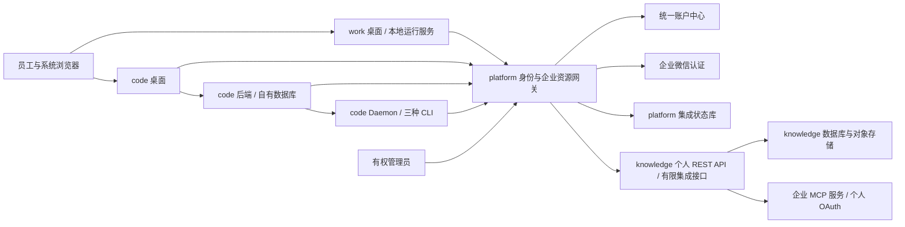

# 双客户端企业资源接入架构

依据：[已确认 Requirements v1.3](requirements.md)、[参与仓及固定基线](../repositories.json)、[当前架构基线](../../../../architecture/overview.md)。

用户在需求确认后的独立消息“Continue”授权本阶段；随后明确“基线肯定一致，你不需要浪费 token 查了”。基线一致按用户确认处理，不再调查版本和部署一致性，不作为本阶段阻断项。本文 v1.0 已由用户在架构及 EXT-001/002 确认请求后回复“Continue”批准；仅确认设计，不表示接口、数据迁移或客户端能力已经实现。下文目标方案已确认，待勘察事实仍须按 OPEN-002 取得证据。

## 已确认约束与现状

### ADR-001 已确认约束：范围与所有权

对应 REQ-001～007、009～012。必须完成 macOS 的 work/code 登录、空间授权、知识库、企业技能和精确 MCP 调用；code 验收 Claude Code、Codex、Kimi Code。组织同步只由有权管理员手动触发。REQ-008 云端 Agent 委托及验证 C 后置，不建立远程 Agent 会话编排系统。

knowledge-opc 仍是云端知识、技能、MCP 配置和空间授权权威；platform-opc 负责身份关联、客户端接入、授权投影和组织管理；两端保留自身引擎。本轮不引入 OpenBao；若方案证明必须引入，先说明必要性及替代方案不足并取得用户同意。knowledge-opc 源码扩展需按 ADR-008 的具体边界单独确认。

### ADR-002 已验证事实：现有能力不能直接等同于目标能力

| 事实 | 代码证据（仓库 ID + 仓库相对路径） | 对方案的影响 |
| --- | --- | --- |
| work 的引擎已有额外工具、技能目录和实时技能过滤接入点 | work-opc `coworker/agent.py:224`，`coworker/server/manager.py:308` | 增加企业资源适配层，保留引擎 |
| work 的默认 SecretStore 为文件存储，运行管理器集中管理会话、MCP 和秘密 | work-opc `coworker/secrets.py:229`，`coworker/server/manager.py:345` | 企业长期凭据不能直接沿用 secrets.json；增加账号/空间运行隔离 |
| 网关已有企微登录桥，但 OIDC token/userinfo 是占位响应 | platform-opc `pkg/handler/handler.go:316` | 双端使用明确的新授权码流程，不把旧接口包装成可用 OIDC |
| 网关与 knowledge 共享 JWT 签发约定并写 auth_tokens；登录按 email/username 找用户 | platform-opc `pkg/auth/service.go:29`，`pkg/storage/storage.go:51` | 隔离兼容桥，改为稳定主体映射；个人上游凭据只留服务端 |
| 网关启动、定时及部门缓存缺失可触发全量同步；停用用户被跳过；已存在成员不更新角色 | platform-opc `main.go:53`、`pkg/syncer/syncer.go:231`、`:258`、`pkg/storage/storage.go:135` | 必须统一到手动同步入口，补清权及来源账本 |
| 账户中心适配器当前部门查询 first:2000，未取完整分页信息 | platform-opc `pkg/accountcenter/client.go:116` | 现有返回不能作为可靠全量清权依据 |
| 技能 catalog 元数据 Viewer 可读，文件预览为 Admin；完整归档位于内部存储服务 | knowledge-opc `internal/router/routes_agent.go:81`、`internal/application/service/tenant_skill_files.go:194` | 不能把预览拼成包，也不能让普通员工借用 Admin 凭据 |
| MCP 有发现、个人 OAuth、策略接口，执行和人工审批主要在 Agent 工具链内 | knowledge-opc `internal/router/routes_infra.go:144`、`internal/agent/tools/mcp_tool.go:146` | 需要独立的精确调用入口，并显式连接安全检查 |
| code 任务领取时 MCP 解析失败会保留原配置；普通技能解析允许返回更新后的内容 | code-opc `server/internal/handler/daemon.go:2555`、`:3979` | 企业受管执行必须失败关闭、固定技能版本 |
| code 的 Claude 默认 bypassPermissions，Kimi ACP 有自动许可逻辑 | code-opc `server/pkg/agent/claude.go:1084`、`server/pkg/agent/kimi.go:62` | 企业模式需单独处理本机许可，不能只修改 MCP URL |

更完整的当前事实与运行拓扑只在长期基线维护。上述事实来自只读源码勘察，不是功能测试结果。

## 目标架构与模块边界

### BND-001 已确认方案：统一网关入口，保留两端执行

外部 HTTPS 入口、服务器间调用、本地桌面与 sidecar、CLI 子进程分别为信任边界。用户、设备、任务、服务身份不能相互替代。网关不是任意 URL 反向代理；只开放固定的业务操作和经服务端解析的资源。

| 编号 | 模块 / 所有者 | 负责与暴露 | 禁止依赖及边界 |
| --- | --- | --- | --- |
| BND-002 | platform 身份与会话 | 企微认证、稳定主体映射、一次性码、会话刷新/撤销、code 后端身份兑换 | 不将 email 当不可变身份；不向客户端返回 knowledge JWT 或管理密钥 |
| BND-003 | platform 资源与运行授权 | 空间投影、知识适配、技能分发协调、任务租约、审计 | 不复制知识索引、MCP 凭据解密/OAuth 刷新，也不维护第二套资源编辑后台 |
| BND-004 | platform 手动组织同步 | 完整快照、差异计划、供给/清权、运行结果与人工重试 | 不通过启动、登录、缓存未命中或 cron 隐式运行全量同步 |
| BND-005 | knowledge 资源执行 | 当前用户资源授权、RAG、归档存取、MCP 连接/策略/OAuth、精确调用结果 | 不接收客户端指定的任意主体；新增接口不跳过现有空间和资源检查 |
| BND-006 | work 企业适配 | 登录入口、安全凭据引用、账号/空间运行上下文、企业工具与技能目录 | 不改写个人执行引擎；云权限不等于本机文件或 shell 许可 |
| BND-007 | code 后端与 Daemon | 身份关联、工作区映射、任务发起人、受管技能/MCP、CLI 本机许可 | 网关不直接写 code 的业务表；Daemon 注册凭据不能单独换取员工资源权限 |

## 身份、授权与撤权

### ADR-003 已确认方案：系统浏览器授权码与独立会话

1. 原生端先绑定 `127.0.0.1` 的临时回调端口，生成 state 和 PKCE S256，再通过系统浏览器访问 platform 登录入口。回调目标只允许预登记客户端与合法回环路径；平台不接受任意外部跳转。
2. platform 用企微认证取得外部身份，再关联账户中心的稳定主体。候选键为 `(identity_source, organization_id, immutable_subject)`；账户中心 `SysUser.ID` 的永久性须确认，不能靠 email/name 自动合并。
3. 登录只核验该人的身份、停用状态和已有供给关系，不触发组织全量同步。未供给或映射冲突时不给企业资源权限，提示管理员手动处理。
4. 浏览器只返回短时、一次性的授权码及 state。服务端将码绑定客户端、回调、PKCE challenge、登录事务及设备；兑换原子消费，重放失败。具体 TTL 和错误码留 Specification。
5. work 获得 platform 会话。code 通过绑定 `aud=code-backend` 的一次性兑换材料，让自己的后端验证并映射本地用户，再签发自己的会话。不能把 platform access token 当 code JWT，不能把一次兑换材料重复用于两种受众。
6. 企业 refresh 凭据进入 macOS Keychain；renderer 只获必要的短时状态。访问凭据尽量留原生主进程或受保护 sidecar；刷新轮换、复用检测、退出及停用都关联服务端会话。

服务间调用使用独立服务身份与受众验证，只允许指定操作；“某个服务可调用接口”不代表它可任意声明员工。code 的发起人必须由已认证请求及持久化任务来源确定；无明确发起人的企业任务拒绝派发。认证算法固定白名单，不复用 knowledge/code 签名密钥签发平台客户端凭据。

**被否决的备选：**共享 endpoint token、用户名/邮箱自动联号、将长期 token 放回调 URL、直接沿用占位 OIDC、将所有产品切到同一 JWT。

### ADR-004 已确认方案：稳定主体与受控的 knowledge 兼容桥

platform 保存身份映射及组织受管授权的来源；knowledge 仍裁定最终空间/资源权限。code 保留独立用户、工作区及任务库，新增平台主体与 code 用户/工作区的显式关联，不迁走业务数据。

本轮允许将现有 knowledge JWT/auth_tokens 约定封装在 platform 的窄兼容适配器中，作为现有登录桥的受控演进：只为已验证且有效的映射用户、当前允许空间生成短时个人上游会话，永不交给员工电脑；不签管理员代理 token。数据库账号限制到已列明的身份/成员/token 操作，凭据单独受控注入。新客户端会话签名密钥与此兼容密钥分离。

该方案保留上游耦合成本，因此必须对固定 release 的 token 持久化、停用、成员变更和撤销做契约测试。契约不兼容即阻断相关接入，不能临时提升权限或随意改表。新增正式身份供给/令牌兑换 API 是另一项独立演进，不因批准技能/MCP 扩展而自动获准。

组织角色不是客户端自报值。自动来源和手工来源分别记账；收回组织授权只影响该来源。停用/离职属于全局身份失效，即使历史手工授权记录仍保留，也不能继续访问。对缺乏来源证据的存量成员，不自动认定全部属于组织同步。

### ADR-005 已确认方案：逐次授权与短期运行租约

每次企业调用由网关检查主体、会话、空间、能力、资源和授权版本；knowledge 再用个人身份执行资源级检查。code 的任务授权额外绑定 task、runtime/device、workspace 和 originating user；work 绑定账号、空间和本地会话。CLI 只拿调用当前任务所需的短时能力，不拿 refresh 或上游 OAuth 凭据。

撤权事务先持久化拒绝访问的身份/授权版本，再尝试通知两端和中止等待调用。通知失败不影响拒绝生效；派发、租约续期和每次云调用均读到撤销结果。任务 lease 和各缓存的累计陈旧窗口必须小于 REQ-003 的 60 秒预算，具体预算在规格中固定；敏感写调用必须在线检查，不能凭缓存完成写入。

code 的 JWT、PAT、任务 token、WS 和 Daemon 入口均接入企业主体状态检查，不只拦 UI 登录；旧 WS 连接在撤权后不得继续发起有效企业操作。非企业个人功能按原权限保留。账户中心变更至管理员手动触发之间没有自动检测 SLA；同步成功应用后才计算 60 秒。

已发送到外部服务的写入可能无法取消；中止后如结果不明，记录结果未知，不重试或声称已回滚。已下载信息不承诺远程擦除。

## 企业资源链路

### ADR-006 已确认方案：知识库用个人 REST 权限，不增加第二套 RAG

两端通过 platform 的知识操作适配访问 knowledge 的 KB 列表、检索、内容读取与引用。优先使用现有个人 JWT REST 路由，如 `/:id/hybrid-search`、知识预览等。服务端从已验证空间解析 KB/document ID；引用跳转和下载再次授权。Viewer 的预览权不升级为原文件下载权。

返回规范化的来源空间、知识/片段 ID、标题、定位和内容；模型生成仍由原客户端引擎负责。共享 `/mcp/:endpoint_id` 仅作为有机器主体语义的旧接入，不作为新员工入口；新方案不依赖 `ask`，不增加云端 Agent 委托。

### ADR-007 已确认方案：完整技能归档、不可变发布与受管安装

knowledge catalog 是定义源。推荐在 knowledge 内增加本地分发的发布记录：源 catalog、版本、实际字节哈希、不可变归档引用、适用客户端、执行方式、依赖声明及分发策略。普通员工“能看 catalog”不自动等于“能下载任意脚本”；管理员明确发布给允许空间/角色后，个人身份才能获取归档。

platform 保存跨空间发布任务的进度、幂等键与源/目标映射；它负责协调，不形成可独立编辑内容或扩大授权的技能后台。母空间广播沿用显式目标选择，只复制发布的目录项和归档，不默认安装到所有云沙箱。授权的管理操作与员工下载路径分离。

归档下载前按个人权限检查发布状态，固定 `release_id + SHA-256`，读取 knowledge 自己的文件服务；不从预览拼包、不暴露 MinIO 凭据/任意存储路径。catalog 更新或删除不允许覆盖已发布版本的字节；不可变归档保留到引用释放且审计保留期结束。

两端先下载到隔离临时目录，检查字节哈希、文件数/大小、路径/链接、manifest 与依赖，再原子安装。缓存键包含部署 issuer、员工主体、空间、技能发布 ID 和哈希；目录显示名不作为授权标识。code 企业技能不能套用“请求旧 hash、返回最新包”的普通技能行为。

执行前刷新分发授权，离线不启动新的企业技能；撤权停止新加载及后续云调用，已在本地执行的进程按原本机权限管理，不承诺清除用户已取得内容。首轮支持本地执行及通过受管 MCP 访问云资源的技能；仅适用于云沙箱的包不可被错误装成本地技能，也不为其补建云端 Agent。不得默默运行包内安装脚本或安装缺失依赖；必要本机操作走客户端许可流程。

### ADR-008 已确认约束：knowledge 两项有限扩展的批准范围

源码调查未发现满足以下契约的公开入口；下面两个模块边界已获用户批准，**不是仅增加两个函数的承诺，也不绕过规格及任务门禁**。正式 HTTP 规格下一阶段固定。

| 编号 | 建议扩展 | 必要原因 | 允许改动与约束 | 不推荐的替代方案 |
| --- | --- | --- | --- | --- |
| EXT-001 | 本地技能发布记录与授权完整归档导出 | catalog 文件预览是 Admin 路径；现有 catalog 可更新，不足以保证普通员工获取固定完整版本 | 新增发布记录/不可变归档引用和发布、查询、下载接口；复用现有 catalog、空间 RBAC、文件服务；不改变云沙箱安装流程 | 网关直接读对象存储虽可避免源码改动，但会复制存储解析、授权和版本保留逻辑；预览拼包不满足完整性 |
| EXT-002 | 逐工具精确调用与请求级结果管理 | 现有 MCP 服务路由无对应调用入口，现有审批依赖 Agent 执行上下文 | 独立 integration 调用适配、必要调用记录、状态查询/取消/人工决定；复用 MCP manager、个人 OAuth repo、工具策略；补请求级审批，不启动模型或 Agent 会话 | 让 `ask` 猜工具不精确；网关复制密钥解密/OAuth 刷新违反所有权；直接调用底层 CallTool 会漏掉策略/审批 |

**升级影响：**新增隔离路由、适配模块、少量数据模型与迁移；触及现有注册/依赖注入及安全服务调用点。每项需要固定 release 契约测试与回归；未知实际 diff 不预先宣称“零维护成本”。保持上游原有路由与表字段兼容，禁止修改检索引擎、替换 Agent 引擎或解除 stdio 安全限制。knowledge 默认客户端禁用 stdio；未来若存在经验证的服务端受控执行路径，只能在服务器内使用，不能为本轮在本机直接执行云命令。

用户已批准两项限定扩展；正式实施仍等待 Specification/Tasks 确认。既定技能/MCP 需求不能以关闭能力冒充完成，超出上述范围的 knowledge 改动须另行说明并确认。

### ADR-009 已确认方案：精确 MCP 的调用安全与审批归属

客户端工具目录来自“当前空间可用服务及工具 ∩ 受管策略 ∩ 本机许可”，工具身份使用稳定 service ID 和原始 tool name，不只依赖可重名的显示名称。网关不接受任意上游 URL、命令、环境变量或解密后的凭据。

knowledge 的 integration 入口接收个人上游身份与可信网关签发的短时调用上下文；上下文绑定 user、tenant、actor kind、request、task/device、目标操作和参数摘要，验证 issuer/audience/期限及防重放。两份身份必须一致；客户端自报 header 无效。运行调用与人工审批是不同操作权限，CLI/Daemon task token 无法换取审批凭据。

执行顺序：记录幂等请求 → 校验当前用户/空间/资源 → 工具 enabled/risk/access-level 策略 → 必要人工审批/个人 OAuth → 执行前再次授权 → 精确调用 → 记录结果。现有 `MCPTool.Execute` 的审批分支依赖执行元数据，不能假设直接调用它会自动拦下审批；适配层必须明确提供请求级审批上下文，缺少它就拒绝危险调用。

OAuth token 继续由 knowledge 按原个人 principal 保存、刷新与撤销。登录属于不同员工时不能复用 MCP 连接；有效许可范围内可跨请求复用授权。人工决定由双端可信 UI 展示目标、参数和后果后提交，绑定请求、最终参数摘要和策略版本；参数修改须重新校验并绑定到决定，重复决定不能重复执行。

精确调用有持久化的 request ID、状态及有限期限结果查询。断网后查询原请求，不重新提交写操作；取消未开始的操作可确定取消，已发送的操作以实际回执为准，未知结果不自动重试。进程在“已发送但未记录结果”间崩溃时记未知；没有上游幂等契约就不承诺 exactly-once。只在确定未发送或上游明确保证幂等的范围重试。

## 客户端与组织管理

### ADR-010 已确认方案：原生凭据宿主和受管运行上下文

work：增加企业身份/资源适配模块，利用 `extra_tools`、`extra_skill_dirs`、`skill_filter` 接入。新企业会话持久化主体与空间绑定；运行缓存键含账号、空间及会话 generation。切换账号/空间时终止旧企业连接与等待审批，重建对应上下文，不能把已有 engine 重新贴标签给新账号。企业 refresh 使用原生 Keychain 适配，不进入现有 SecretStore 文件。

code：在 core 层承载无 UI 的企业 API/类型，在 views 层提供共享登录/空间/审批行为，Electron 主进程负责 Keychain 与浏览器回调，Daemon 负责受限执行。新增字段向旧客户端提供兼容默认值，但未声明支持受管协议的旧 Daemon 不得领取企业任务；其个人任务按原行为处理。

CLI 侧通过本地受保护桥访问平台，或使用任务限权的远程连接。主进程/Daemon 内持有任务凭据，普通配置只保存桥连接引用；不得把长期 token 放进命令行或生成的 MCP 配置。任何 loopback 桥必须校验随机会话能力、绑定任务上下文及允许来源，不能只靠 localhost 当认证。

企业任务明确设置受管 MCP；合法空集合与未配置不同，解析/授权/网络失败中止企业调用，不落回用户本机全部 MCP。Claude 移除企业模式默认 bypass；Codex 验证实际 sandbox/approval 参数；Kimi ACP 的权限请求转入有权用户的本机审批或拒绝，不能自动选择允许。无人值守任务只执行预先明确允许的本机范围，不能通过云审批自动扩大。

### ADR-011 已确认方案：手动同步运行账本

复用管理入口，但所有全量/单范围触发归一到同一同步服务，返回运行 ID，可查询进度、范围、差异及失败。任务使用独立受控生命周期，不能把已返回 HTTP 请求的 context 交给后台协程。运行及锁持久化，进程内布尔变量不能承担跨实例互斥。

阶段为“抓取完整权威快照 → 校验 → 计算差异 → 分步应用 → 核对”。同一来源/范围互斥，重复 idempotency key 返回原运行；失败保留已应用项和可重试项，不把部分失败报告成功。分页中断、空快照、单部门失败时禁止据此批量删除。

初始映射保留已确认的部门规则，规则版本随计划记录；新员工/部门正向供给和调岗增新收旧都在手动运行中完成。knowledge 与 code 不做分布式数据库事务：用幂等步骤及结果账本恢复。撤销先在网关拒绝，再重试各产品落地；供给未完整完成时不授予未确认资源，管理员能看到部分失败。保留手工授权来源，不能以“重新同步”恢复已停用用户。

## 数据、迁移和兼容

### DATA-001 已确认方案：数据所有权与变更清单

本轮涉及数据模型变更。下表是需要持久化的逻辑对象和约束，最终表名、字段和索引在 Specification 固定，不在此生成 SQL。platform 使用自己的逻辑库/数据库角色，可复用现有 PostgreSQL 集群，不要求新增数据库产品；code 与 knowledge 保持各自库和迁移工具。新平台状态不塞进 knowledge 原业务表。

| 编号 | 所有者 / 新增或修改对象 | 关键约束与存量处理 |
| --- | --- | --- |
| DATA-002 | platform 新增 identity_links、workspace_links | 来源/组织/主体唯一；knowledge/code ID 显式关联；冲突隔离，不按同名/email 自动绑定 |
| DATA-003 | platform 新增 auth_transactions、sessions、runtime_grants | 一次性码原子消费；refresh 只存验证哈希；受众、设备/任务、权限版本、期限和撤销状态；已有会话不自动升级 |
| DATA-004 | platform 新增 managed_entitlements、sync_runs、sync_steps、audit_events | 来源与规则版本、执行幂等键、锁/租约、步骤结果；存量来源不明的授权默认不自动清理 |
| DATA-005 | platform 新增 skill_publish_jobs | 源/目标发布引用、幂等键及状态；内容与最终分发权限归 knowledge，不能在此独立编辑 |
| DATA-006 | code 新增企业身份/工作区关联与任务授权引用 | 企业主体关联、任务发起人、授权版本/lease 引用；不存 knowledge 凭据。旧任务字段为空且保持个人任务语义；禁止将空字段解释为无限企业权限 |
| DATA-007 | work 新增企业 profile/context 元数据 | 非秘密的 issuer/subject/space/generation、Keychain 引用；旧会话保持个人归属，首次登录不自动搬入另一账号 |
| DATA-008 | knowledge 新增技能发布与归档保留记录，依赖 EXT-001 批准 | 固定 catalog/release/hash/策略；现有 catalog 不自动获得可下载授权；无完整源归档的条目待管理员重新发布 |
| DATA-009 | knowledge 新增或复用精确调用请求/审批结果记录，依赖 EXT-002 批准 | actor、tenant、参数摘要、幂等键、执行阶段、结果引用；绑定单次请求，不回填 Agent 历史为精确调用 |
| DATA-010 | knowledge 现有 users/members/auth_tokens 的受控数据变更 | 沿用兼容桥的身份供给/授权/撤销；须核对真实字段与契约，不自行改原表结构；禁止重新启用已停用用户 |

code 不增加外键或级联删除；新增索引按仓库规则采用独立单语句 `CREATE INDEX CONCURRENTLY` 迁移。平台新增迁移显式版本化，不把 GORM 启动 AutoMigrate 当可审查发布流程。知识扩展迁移按现有仓库约定执行，禁止顺便大规模改表。

### DATA-011 已确认方案：迁移、存量与回滚路径

1. 对固定目标执行 schema/权限契约检查，在具有代表性存量数据的隔离副本生成身份冲突与授权来源报告；列出映射不明的员工、部门和手工授权，先隔离，不推断绑定。
2. 先增加新表/可空字段和索引，服务保持企业能力关闭；失败保留迁移日志，按每项可重复或修复步骤处理，不启动半迁移应用。
3. 已确认的主体映射和授权来源分批回填，保留旧值、来源和操作者；无法确定的行进入管理员处理清单。先用一个部门验证新登录和手动供给/清权，旧个人数据不搬迁。
4. 发新凭据、发布技能版本、启用受管客户端。历史共享 endpoint/旧 token 先盘点受众，再按切换清单撤销或轮换，不能无界保留以绕过撤权；回滚也不能重新启用泄露/已撤销凭据。
5. 回滚先停止新派发和新写入，保留审计及未知执行记录；关闭企业入口，再回退客户端/code、platform、knowledge 扩展。保留新增表以支持向前修复，不在第一次回退时 DROP 表。
6. 本轮不删除原有业务表/字段。成员变更只按来源及变更账本补偿，不能用全库恢复覆盖同期合法操作；涉及真正恢复数据库时单独确认准确目标、备份和影响。

兼容窗口从 additive schema 部署开始，到试点两端/Daemon 升级、旧凭据切换、必要契约及回滚验证通过为止。窗口内旧客户端可使用原个人能力，但不能领取企业任务；窗口结束不自动删旧表或旧 API，删除行为另行规划并确认。回退不能回到暴露无鉴权管理接口的版本；没有安全旧版则保留加固层并关闭企业功能。

### MIG-001 已确认方案：代码结构迁移映射

| 编号 | Source | Target（候选模块） | 处理方式 |
| --- | --- | --- | --- |
| MIG-002 | platform `pkg/handler/handler.go` 登录/同步混合逻辑 | 平台 identity/session、sync-run 服务与薄 handler | 拆分认证、手动同步和个人资源访问；不替换企微 SDK |
| MIG-003 | platform `pkg/auth/service.go` 与 `pkg/storage` | knowledge compatibility adapter + platform 自有状态 repository | 隔离直接 DB/JWT 依赖；新增状态由平台自己的迁移负责 |
| MIG-004 | work `coworker/server/manager.py`、`coworker/agent.py` | 企业 context、resource adapter、native credential adapter | 在既有注入点接入，不复制 TurnEngine |
| MIG-005 | code handler/auth/middleware、Daemon claim/skill cache、CLI adapters | 企业 identity、task grants、enterprise skill source 与受管 CLI 选项 | 扩展原任务链，保留工作区和 Git 模型 |
| MIG-006 | knowledge catalog/file service、MCP manager/policy/OAuth | 隔离的 integration 路由/服务与持久化记录 | 依赖 EXT-001/002 批准；复用内部能力，不搬走或复制上游实现 |

## 集成契约与部署

### INT-001 已确认方案：跨仓契约面

| 编号 | 方向 | 交换内容与约束 |
| --- | --- | --- |
| INT-002 | 两端 → platform | 授权码/PKCE、会话、主体/空间投影、资源操作；服务器重验所有 ID，返回稳定业务错误与 request ID |
| INT-003 | code backend ↔ platform | 后端受众的身份兑换、主体/工作区映射、明确发起人的任务 grant、授权状态查询；服务认证与员工授权分开 |
| INT-004 | work/Daemon → platform | 绑定会话/任务的限权调用、租约续期、固定技能包请求；不能操作组织同步或替人审批 |
| INT-005 | platform → knowledge | 个人 JWT REST；新增接口附可信调用上下文；资源 ID/角色由 knowledge 再验，敏感凭据不出服务端 |
| INT-006 | platform → 账户中心/企微 | 企微认证与账户中心稳定主体、状态、部门快照；超时/分页完整性可观测，不把查询失败当不存在 |
| INT-007 | knowledge → MCP 服务 | 原有连接、OAuth、策略与网络出口限制；工具参数、幂等/超时与结果关联，不把外部错误当成功 |

API 路径/字段/错误码在 Specification 固定。契约版本与客户端 capability 共同控制企业任务；不根据 CLI 显示版本字符串推断安全支持。

### ADR-012 已确认方案：最小发布拓扑和顺序

沿用现有测试服务器/基础设施，不新增 OpenBao 依赖。platform 自有状态库与 code 独立逻辑库可使用同一 PostgreSQL 服务但不同账号；不共用业务表。部署 overlay 与配置引用由集成侧维护，knowledge 原 compose 不承担双客户端的配置中心职责。

客户端通过受信 HTTPS 访问 gateway/code。网关新公网入口在管理鉴权、TLS、来源/CSRF、密钥注入及负向用例通过后才开放；可使用独立域名或既有入口明确路由，域名在发布清单阶段确定。管理入口优先内网，不向员工公开高权操作。上游文件/OAuth 回调只经过限定路由；不向公网开放数据库或 Docker socket。

发布顺序：备份与隔离副本验证 → additive schema → knowledge 扩展（批准后，功能关闭）→ platform 加固/新接口 → code 后端及 Daemon → 双端客户端 → 单部门启用 A/B/精确 MCP → 扩大试点。依赖握手失败只关闭受影响调用，不能降级到管理员身份。

本轮只做固定版本的必要契约、灰度和回滚验证；不建设通用发布平台。最终唯一 release-checklist 在后续 Tasks/Implementation 按实际脚本与配置完善，未执行的发布不勾选。不存在 FilerUI 使用证据，目前不引入，后续清单按真实配置来源写 N/A 或准确定位。

## 测试、恢复与决策缺口

### VAL-001 已确认方案：验证边界

| 扩展 | 本阶段确定的验证责任 |
| --- | --- |
| Testing | platform 测身份/同步/租约与 knowledge 契约；work 测 context/Keychain 适配和工具注入；code 测身份、PAT/WS/任务/Daemon、固定包、三 CLI 参数；knowledge 测发布权限/归档与精确执行。随后做 macOS 双端真实纵向用例 |
| PBT | 固定输入域：用户/空间/角色变化、重复兑换、撤销与续期交错、手动同步重复/部分失败、恶意 ZIP 路径、发布版本替换、审批参数变化。验证权限不扩大、单次消费、不可变字节与无重复副作用；先用现有框架，新增库不作为前提 |
| Security | 未认证/跨空间/跨账号、伪造 actor、执行 token 自审批、过期凭据、旧 endpoint 绕行、SSRF/重定向、路径/链接、日志与子进程凭据泄露 |
| Resiliency | 账户中心分页中断、DB/授权服务不可达、CLI 桥断开、归档半下载、OAuth 失效、MCP 超时/取消/结果未知、多实例同步竞争和重启恢复 |

沿用各仓实际测试入口：work 的 pytest/GUI Vitest/build；code 的 Go tests、pnpm typecheck/lint/test 及 Playwright；platform 的 `go test ./...`；knowledge 的相关 Go 包及 frontend type-check/test。本阶段仅检查文档和事实，不执行这些业务测试，也不将源码阅读记为 PASS。code 的真实 CLI 冒烟仍遵守其仓库显式授权与 `agentintegration` 开关要求。

### OPEN-001 已解决：本阶段决定

用户在本版架构和两项扩展确认请求后回复“Continue”，确认 Architecture v1.0 及 EXT-001/EXT-002 的限定范围。维护代价是隔离模块及版本契约测试；不会由此自动批准身份供给 API、引擎改造或 OpenBao。没有“已问但用户答不上来”的问题。

### OPEN-002 待勘察：规格确认前补齐

- 账户中心稳定主体的永久性、完整分页及停用/删除语义：已有代码仅证明字段存在；实现前取得契约或脱敏样例。不可用时停止该映射/批量清权，不猜测。
- 身份冲突与历史授权来源：在授权的测试数据上形成可审查回填清单，不能默认安全自动合并。
- 原生 Keychain 桥、三 CLI 的受管参数与审批传递：在 Tasks 中安排可执行验证；无人值守权限不能凭注释推断。
- 技能 manifest、可本地运行的代表性包、MCP 读/写/OAuth/审批测试工具：从现有试点资源选取，不把环境缺失当通过。
- macOS/CPU 与 CLI 具体版本、试点部门/账号、同步处理时限、实际并发/p95：先盘点可用环境，再在 Specification 固定；1000 人不等于 1000 并发。

基线一致已由用户确认，不重复列为缺口。以上未决项不授权任何源码改动、共享环境迁移或部署。Architecture 确认后才创建 Specification；Tasks 确认后由 Kimi 实施。

## 确认记录

确认人：Roger0808 / yj198788@hotmail.com（本对话用户）。记录时间：2026-10-20T19:07:51+08:00。确认版本：v1.0，批准前 SHA-256 `c22b20ea8cdedb026d6b67a475054ec653fb403e33666cdc2e469eb5dc989a70`。用户在收到架构与 EXT-001、EXT-002 的具体确认请求后回复：“Continue。你的 token 快不够了，你写一份交接文档，接下来都让 kimi 干吗，他和你是同一台本机，拥有一样的权限”。按该上下文记录设计与两项限定扩展批准，并将后续文档和实施交由 Kimi。本次仅更新确认状态/分类及留痕，不更改设计内容；未创建规格或实施代码。
