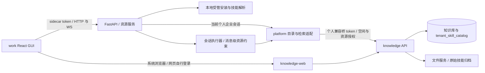

# work-opc 知识库与技能轻量入口：架构方案

本方案以本需求 Requirements 及 2026-10-22 用户后续决定为边界。用户已授权继续架构设计；本文件已由用户确认，进入 Specification 仍需后续独立继续指令。架构批准不等于实现，所有本轮新增设计均尚未实现。本次只调研、修改文档，没有改业务代码或执行迁移。

## ADR-001 已确认约束：简单客户端，网页管理

对应 REQ-001/002/005/009。work-opc 提供知识库轻量列表、知识范围选择、技能列表与手动安装使用；上传只调用系统浏览器打开 `https://shtokendance.benlai.com`。不新增上传专用深链，不传客户端登录态。详情与引用复用网页资源定位；网页独立登录及鉴权。

用户最新决定：“code-opc 的不用管，上个 loop 的旧 release 也没有测试通过，可以直接删除的”。据此不保留旧技能 release 发布/分发链路的兼容，不修改或验证 code-opc。此处的技能 release 与既定 Git release 基线分支无关。

主仓 work-opc；参与仓 platform-opc、knowledge-opc。唯一需求、总架构及治理留在主仓，不改变参与仓 activeLoop，不复制第二份可编辑需求。

## ADR-002 已验证事实：源码、依赖与能力缺口

核对对象为已固定 release SHA 的工作区代码；work 既有四个暂存改动属于用户已有内容，不作为本轮交付。固定版本以 ../repositories.json 为准，不重新选取远程分支。

| 系统 | 当前事实和证据 | 需要改变的边界 |
|---|---|---|
| work GUI | React 18、TypeScript、Vite、Tauri 2；`SkillsTab.tsx` 管理本地技能；`Composer.tsx` 与 `api.ts` 发送独立 skill 字段 | 资源列表、知识范围标签、稳定技能 ID 与安装状态 |
| work 服务 | Python >=3.10、FastAPI；`server/app.py` 的 user_message 校验技能名称并构造 load_skill 提示；`enterprise/tools.py` 支持 knowledge_base_id，read 仅按 knowledge_id 请求 | 消息级执行约束及 read 来源校验；不能只给模型提示 |
| work 技能 | `enterprise/skills.py` 校验 opc-client.json 和 payload digest，目录按 tenant/publish_id；`manager.py` 的 _schedule_catalog_sync 自动安装 release | 改为 catalog 原始归档与显式安装；新记录需要账号隔离及稳定资源身份 |
| work 持久化 | `conversations.py` 的 _append 写完整消息字典到 JSONL，SQLite 维护会话索引 | 消息附加字段不必为此新增 SQL 列；provider 请求前剥离内部字段 |
| platform | `knowledge_upstream.go` 已有 listKnowledgeBases；`main.go` 未对客户端暴露此列表；skills handler 仅查 published releases | 增加目录列表和直接归档代理，移除旧发布协调与分发 |
| knowledge | `tenant_skill_catalog.go` 的 catalogBundleArchive 可读目录归档并核验 SHA；`TenantSkillCatalogEntity` 已有 BundleRef/BundleSHA256 | 新增当前目录原始归档下载，不经过 release |
| knowledge RBAC | catalog GET Viewer+；上传与文件内容读取 Admin+；release 归档原为 Viewer+（routes_agent.go） | 单独定义目录归档分发入口，不放开现有 Admin 文件管理接口 |
| knowledge 网页 | KB 详情 `/platform/knowledge-bases/:kbId`，支持 knowledge_id；Skills `/platform/toolbox/skills` 由 SkillSettings 管理 | 技能详情需小型定位适配；上传只开首页 |
| 旧链路调用 | code 的 platform client 调用 `/integration/v1/internal/skills`；knowledge 容器注入 release repo/service；DeleteCatalog 检查 release 占用归档 | 按用户决定删除三仓旧链路及注入，不以 code 依赖阻止 |

重要差异：现有 install_enterprise_skill 的注释称原子替换，但当前实现先 rmtree 再 move，存在失败时丢旧版本的窗口；新安装不能照搬该替换方式。现有授权刷新只检查平台 session，不足以单独证明某个 catalog 仍可用，需要资源级复核。

本机已存在 pytest、Vitest、Playwright 与 Go 测试入口；本阶段没有运行实现测试。工程扩展 testing/pbt/security/resiliency 全部适用，无新增第三方依赖需求。

## ADR-003 已确认方案：目标架构与模块边界

| 模块 | 责任、对外能力 | 依赖限制 |
|---|---|---|
| GUI 资源视图 | 知识库及企业技能列表、搜索、状态与操作入口；复用已安装技能管理 | 不持有平台 access token，不直接请求 knowledge API |
| GUI composer | 本条消息资源选择、草稿、发送与历史标签 | 发送 ID 而非信任显示名称；错误保留草稿 |
| work enterprise resource service（新增小模块） | 列表适配、安装请求、资源身份核验、状态归一化 | 依赖 auth/bridge 与 installer；app.py 仅路由，manager 仅编排 |
| work turn scope（新增小模块） | 为每个 turn 固定身份、知识库及技能版本，清理 scope | 不能修改进程级共享全局来传递消息范围 |
| work managed installer | 校验原始包、安全解压、版本落地、激活及回收 | 不执行安装脚本，不写个人技能根；不依赖 publish_id |
| platform resources adapter | 当前用户可见空间/KB/catalog 列表及归档下载，错误映射与审计 | 不直接查知识内容/技能业务表，不持有 Admin 身份代用户 |
| knowledge catalog archive | 从 tenant catalog 解析权威归档、哈希和权限，返回当前版本 | 不创建发布记录，不复制 release 对象，不返回存储内部路径 |
| knowledge web | 详情、上传、空间选择与权限提示 | 独立会话；不消费桌面凭据 |

新 work 模块建议位于 `coworker/enterprise/resources.py` 与 `scope.py`；GUI 复用现有导航及 SkillsTab，并增加知识列表组件。文件拆分为实现建议，模块责任和依赖方向为本架构约束。

## ADR-004 已确认方案：知识范围由执行层约束

对应 REQ-003/004/008。建议首版每条消息选择一个知识库，以与现有单 KB 检索接口一致；移除或更换标签均在发送前完成。单选是待本架构确认的产品取舍，不是已确认事实。未选范围保持当前按需检索。

WS user_message 增加可选结构化 knowledge_scope：tenant_id、knowledge_base_id；显示标题可由服务端补齐。消息接收时重新核验可见性，绑定当前企业 context key 与 turn ID，保存到该条消息。模型不能通过自行给 space 或 knowledge_base_id 参数绕过选择：工具适配器固定使用范围，冲突参数显式拒绝。

scope 不是 session 永久配置。执行队列中的每个 turn、重试、断线恢复及必要子任务都显式携带同一个范围；结束/取消后清理，下一消息无范围则恢复缺省。无法安全恢复范围的历史任务应要求重新发送，不能猜全库。并发 session 的范围不能共享。

knowledge_read 也必须验证文档实际归属所选 KB。优先让平台在取回内容前检查其 KB 元数据；work 还维护本 turn 检索命中文档集合，不能借旧 turn 的 ID 直接读取别库。仅在提示词写“只搜索 A”不足以满足要求。所有新增企业检索和读取经过该约束；历史对话中已存在的文本不能被撤销或宣称已从模型上下文删除。

引用保留 tenant/KB/knowledge ID 与标题，由可信网页基地址构造链接；外部任意 URL 不自动成为详情链接。未授权或已删除时网页及客户端显示失败，不能扩大搜索范围补结果。

## ADR-005 已确认方案：目录原始归档直接安装

对应 REQ-005/006/007。流程固定为：上传保存 catalog 归档 → 客户端刷新读取 catalog 元数据 → 用户点安装 → 按 catalog ID + 预期归档 SHA 下载 → 校验、解压并激活 → 选用发送。链路没有 publish、release 或 published 状态，也不调用后台自动发布。

### INT-001 建议接口边界

以下是候选接口家族，具体字段、分页、错误码和限制在 Specification 固定。

| 方向 | 建议入口 | 权威与关键交换字段 |
|---|---|---|
| GUI → work | `/v1/enterprise/resources/knowledge-bases`、`/skills` | 当前身份，tenant/KB/catalog ID、名称、简介、安装/可用状态；不得信任前端权限判断 |
| GUI → work | 显式 install/update/disable/uninstall 操作 | catalog 复合身份、预期 SHA、操作结果；同一对象串行化 |
| work → platform | `/integration/v1/resources/knowledge-bases`、`/skills` | 当前个人会话；空间过滤及资源级校验 |
| work → platform | `/integration/v1/resources/skills/:catalog_id/archive` | tenant + expected_sha256；内容与响应 SHA 一致 |
| platform → knowledge | 已有 `/api/v1/knowledge-bases`、`/skills/catalog` | 按已授权空间签短期个人桥 token，归一化资源元数据 |
| platform → knowledge | 新增 `/api/v1/skills/catalog/:id/archive` | Viewer+ 且当前空间成员、目标目录归属与可分发资格；固定预期 SHA；字节完整返回 |
| turn → platform | 复用 knowledge/search、knowledge/:id | 加入实际 KB 归属校验；无范围调用保留既有行为 |

目录 identity 使用 issuer + subject + tenant_id + catalog_id；version 是显示信息，bundle_sha256 是内容固定依据。空间不同但同名的目录不合并。platform 仅在当前 entitlement 内逐空间查询；返回部分错误时必须显式标示，不把失败空间当作空列表。

归档接口依据目录记录与文件服务读取完整字节并重新验证 SHA。客户端用列表 SHA 发出条件下载；更新竞争返回版本冲突，刷新后由用户再次确认更新，不静默安装更新后的其他字节。目录删除或归档不可用直接拒绝，不回落到同名技能、旧 release 或云端沙箱文件。

普通上传包通常只有标准 SKILL.md，不保证有上一轮专用 opc-client.json；因此新安装复用原始技能包解析与安全限制，以标准 SKILL.md 为入口，不要求发布清单，也不修改原始字节来补发布元数据。执行约束由本地受管记录与当前授权持有。已有 zip 解析函数的路径/压缩大小/文件数限制可复用；规范中补测试嵌套目录、重复条目、链接和超限文件。

## ADR-006 已确认方案：安装身份与运行版本

新安装根与旧 `opc/<tenant>/<publish_id>` 分开。建议 `enterprise-skills/catalog/<身份哈希>/<tenant>/<catalog_id>/<bundle_sha256>/`，哈希输入包括 issuer 与 subject；路径片段全部校验，不把用户输入直接拼入路径。tenant 本身不能隔离同租户不同用户。

状态记录保存 schemaVersion、source=catalog、身份摘要、tenant/catalog ID、名称、版本、archive SHA、启用状态及安装时间；不保存 Token。解压到同盘 staging，完成校验后 rename 到不可变版本目录，再原子替换 active 记录。写 active 失败保留旧 active；进程崩溃后只加载完整版本，残留 staging 可清理。不能先删旧目录再移动新目录。

更新、停用、卸载针对复合资源 ID；同名显示为“个人 / 企业·空间”，服务端 loader/registry 按 ID 解析，不能继续依赖 SkillLoader 以 name 作为唯一键的后写覆盖。旧个人 /name 保持原行为；企业选择走结构化 skill_ref，绑定 catalog ID + SHA，直到完成 turn。

建议更新仅影响新启动的 turn；运行中任务固定原目录，停用/卸载立即禁止新启动，正在运行的文件引用结束后再回收。权限撤销与身份切换优先于版本固定：后续企业 load/read/工具执行拦截，不能因“已开始”继续取得新企业资源。已加载指令及已经发出的外部副作用不可撤回，界面不得作相反承诺。

旧 publish_id 安装不能仅凭 name 推断到新 catalog。建议升级后显示“旧版安装，需重新安装”，从执行目录退出，用户显式从目录安装新版本；旧目录先保留以支持应用回退，本轮不无差别删除个人或旧本地文件。此状态是候选迁移行为，随架构一起请用户确认。

## ADR-007 已确认方案：授权与网页边界

沿用现有企业登录、会话撤权与上下文隔离，不新增身份系统。work 在列表、下载、load_skill 和企业工具执行前核验；platform 与 knowledge 仍是最终资源权限决策点。资源授权快照含主体/空间/目录及授权版本，有界缓存应保证从服务端撤权提交到客户端停止新企业访问不超过 60 秒；超时、未知及刷新失败按不可用处理，不能因本地文件仍在而放行。

新 Viewer 目录归档下载是明确的分发接口，必须复用当前空间资源可见性，并限制为目录权威原始包；不把 Admin 文件预览、上传、云沙箱环境变量或发布接口开放给 Viewer。目录权限不足与目录不存在可对外统一不可访问，避免枚举。

上传 URL 固定为已确认 HTTPS 域名；详情链接只允许同一受信域，编码 ID、禁止 javascript/file/任意外域，桌面 openExternal 自行校验。跨空间详情需网页验证成员与切换目标空间，不能只信 query tenant ID。网页登录后返回详情必须保留资源目标；若网页账户无该资源权限，保留拒绝，不代用户切换账户或授予权限。

## ADR-008 已确认方案：删除上一轮技能 release 链路

按用户最新决定删除，而非为 code-opc 保留接口。清理范围如下；不改旧 Loop 归档、旧审计和历史提交。

| 系统 | 删除对象 | 保留对象 |
|---|---|---|
| work | release 列表同步、自动安装调用、publish_id 新安装路径及强制发布 manifest 依赖 | 通用归档安全检查、旧目录隔离识别、身份校验与个人技能 |
| platform | `/skills` 与 `/:publish_id/download` 的旧发布分发实现、`/internal/skills` 旧 release 聚合、admin publish-jobs 两路由、发布 job model/storage 及专属测试 | 新 resources 路由、知识/MCP/身份接口、通用 HTTP 与审计 |
| knowledge | catalog/:id/publish、skills/releases 家族、release handler/service/repository/types、容器注入、DeleteCatalog 的 release 占用判断与专属测试 | catalog 上传、云沙箱安装、现有文件管理权限、新原始归档下载、MCP 相关表与功能 |

旧路由由删除后实际路由行为返回不可用（最终 404/410 语义在规格固定），不重定向到新接口伪装兼容。code-opc 已有调用可能失败，属于用户明确排除的兼容范围，不为此修改 code 仓或声称其验证通过。新 work 与新服务端必须按新资源协议配套部署。

### DATA-001 数据模型变更：删除发布账本

本轮涉及数据模型变更，限定两个旧业务表：knowledge PostgreSQL `skill_release`（含其专属索引），platform 状态库 `skill_publish_jobs`。knowledge SQLite 存在同名表时同样定向删除。保留 tenant_skill_catalog、tenant_skills、MCP 调用表、身份与审计表；不新建“release 改名表”。

添加新的前向清理迁移及配套 down；不删除/重写已执行的 000129 或 000011 历史迁移。SQLite 000046 同时包含 MCP 集成表，不能调用该 down 来整体回退。实际新迁移编号在 Tasks 基于当时最新序列分配；不预占共享编号。

执行顺序：停止旧发布写入 → 对目标表 schema/行、release archive_ref 及相关归档作受控备份并校验可恢复 → 执行新服务端清理迁移 → 部署并验证新目录下载 → 新 work 冒烟。记录迁移实际库、行数、备份校验和与执行版本，文档不写秘密。迁移失败回滚事务并停止发布，不能跳过后继续。

已有数据无需转成新 catalog：新链路直接消费原目录；release-only 记录不能凭名字回填为目录。删除前导出用于回退与追溯。release 归档仅删除经 archive_ref 清单证明为 release 专属、且不被 catalog 或现有沙箱安装引用的对象；共享对象保留。对象存储清理不属于 SQL 原子事务，应在新链路验收后按清单执行，有备份后才可勾选完成；不递归清空 tenant-skills 前缀。

回滚：冻结新客户端操作 → 恢复发布表 schema/数据和必要专属归档 → 校验引用与行数 → 回退 knowledge/platform 旧构建 → 回退 work 构建与旧 active 配置。down 只重建空表不足以恢复数据，必须演练从备份恢复。无可恢复备份时禁止破坏性表/对象清理。

兼容窗口为新服务端/客户端测试切换及回滚观察期；新链路不接受旧 release 协议。观察期结束条件是新知识/技能闭环、迁移回退演练、撤权计时和用户手测通过，并由发布负责人确认。此条件不要求 code-opc 验收。

### DATA-002 本地消息与安装记录演进

会话 JSONL 增加资源元数据、消息级 scope 和 skill_ref，provider 请求序列化应剥离非标准字段；历史无字段消息按缺省读取。SQLite 会话索引不新增列。草稿序列化增加可选范围；旧草稿仍可打开，新字段不能在失败重试时丢失。

新受管安装 JSON 使用独立 schema 和目录，不原地覆盖旧 publish_id 记录。回退应用仍可识别原目录；新目录不会被旧 loader 自动扫描。新版本垃圾回收只处理无任务引用的历史目录，旧格式与个人根不在回收范围。

## ADR-009 已确认方案：部署、观测和失败恢复

部署拓扑沿用：桌面 GUI/Tauri → 本地 sidecar → platform → knowledge API/数据库/对象存储；浏览器访问指定 knowledge-web。无新增服务、端口、消息队列或密钥系统。资源域名作为可信常量/机器级配置，不能由项目目录覆盖。平台地址沿用 opc_platform_base；现有安全 key 注入不改变。

发布顺序为 knowledge（新下载及详情定位、旧链路删除）→ platform（目录代理及旧协调删除）→ work（新 UI/协议）。删除表动作与依赖顺序按 DATA-001 执行，不在旧二进制仍服务期间提前 drop。新端遇旧服务端明确版本不支持，不降级回发布流水线。生产或共享环境执行仍需对应部署授权；当前仅形成设计。

HTTP 保持有限超时，列表可重试、用户可手动刷新；下载中断清 staging，失败不激活。版本竞争刷新后重新选择。写状态操作以同一身份资源互斥及内容 ID 去重，不自动重试已未知结果的外部副作用。身份切换中返回的旧请求结果丢弃，安装完成前再次核验身份，不能跨账号落为 active。

审计记录 actor 摘要、tenant/catalog/KB、版本哈希、操作、结果、耗时、request ID；不记录 Token、完整技能指令、知识正文或下载包。UI 将空列表、失权、服务失败与不支持分开；后端观测列表失败率、归档 hash 冲突、安装失败/残留 staging、撤权刷新失败，不以成功 HTTP 代替业务验证。

## MIG-001～006 代码迁移映射

| 编号 | Source | Target | 处理方式 |
|---|---|---|---|
| MIG-001 | work SkillsTab/Sidebar/Composer | 原入口 + 知识列表 + enterprise resources API | 增量扩展，不搬走个人技能功能 |
| MIG-002 | app user_message、manager turn 编排 | turn scope + 稳定 skill_ref | 结构化透传；历史字段兼容 |
| MIG-003 | enterprise/skills.py release 安装与自动 sync | catalog installer + 显式操作 | 删发布依赖；复用安全解析，重做原子激活 |
| MIG-004 | platform skills handler/upstream + job model/storage | resources adapter + catalog/archive client | 删除 release/job 实现与专属测试 |
| MIG-005 | knowledge release 服务/路由/DI + catalog guard | catalog archive 下载与详情定位 | 定向删除 release，不动 MCP 与云端技能安装 |
| MIG-006 | knowledge skill_release / platform skill_publish_jobs | 新清理迁移、备份恢复工具与证据 | 前向删除，保留历史迁移；精确对象清单 |

## VAL-001 验证边界与必要证据

| 需求/扩展 | 必须取得的验证 | 现有入口 |
|---|---|---|
| ACC-001/003、testing | sidecar/平台鉴权、单库范围、read 越界、并发会话、重试恢复 | tests/test_enterprise_tools.py；platform knowledge_test.go；新增 scope 测试 |
| ACC-002、testing/security | 浏览器首页上传、详情登录返回/跨空间/无权限、外域链接拒绝 | GUI enterprise/Composer 测试 + Playwright；网页路由测试；实际浏览器手测 |
| ACC-004、testing/resiliency | 无 release 目录的上传到安装使用；无专用发布 manifest 包；坏包、竞争更新、原子替换故障、同名分辨 | tests/test_enterprise_skills.py、SkillsTab.test.tsx、Composer.skills.test.tsx；knowledge catalog 测试 |
| ACC-005、security | 真实计时 ≤60 秒撤权；跨主体同租户隔离；失败关闭；个人功能回归 | enterprise auth/context/tools；服务端鉴权与真实桌面链路 |
| DATA-001、resiliency | 空库和含代表性旧行/共享归档的库迁移；备份恢复及回退演练 | 两仓 migration 测试，SQLite 单独验证，不复用 combined down |
| NFR-003、pbt | scope 不扩大、identity 不串用、重复安装幂等、路径不逃逸、active 只指完整校验版本 | pytest/Go/Vitest 固定 seed 生成器；记录 case 数、seed、最小回归反例 |

测试与构建入口：work `pytest`，GUI `npm test`/`npm run build`/Playwright；platform `go test ./...`；knowledge 相关 handler/service/router 单元与集成测试、frontend 类型检查与构建。具体命令由 Tasks 按当前依赖脚本固定，不提前宣称 PASS。不新增 PBT 库，优先现有测试框架确定性生成输入。

## 已完成勘察、未验证事实与待确认方案

- 已验证事实：本机三仓接口/目录/数据结构及测试入口；2026-10-22 对指定 HTTPS 首页执行只读 HEAD 返回 200、text/html。此项仅证明入口响应，不证明网页版本、登录或上传成功。
- 待环境验证：knowledge-web 实际部署来源、详情跨空间及登录后返回；桌面企业登录 `/callback` 全链路。源码地址已改正确，但历史 DMG 曾失败；若复测失败，作为本轮闭环阻断按真实原因修复/确认影响，不跳过。
- 本次确认的取舍：本条消息知识库单选、旧本地 release 安装“需重新安装”、运行任务版本固定及延后文件回收；以及本架构定义的旧链路/表清理方案。
- 未实施：本文件的所有新增接口、数据清理、GUI 与 scope 均未编码、测试、提交、推送或部署。后续以实际实现反向更新长期基线，不把该方案当成运行事实。

## 长期基线关系

本轮审查并更新 `docs/architecture/overview.md` 的历史/当前事实区分和当前能力缺口，不把上述候选方案写成已实现。旧 OPC-INTEGRATION-001 架构只作归档追溯；其技能发布约定被本需求新决定替代，但历史证据不改写。

## 架构 v1.0 确认记录

- 确认者：Roger0808 / yj198788@hotmail.com（当前 Git 治理身份）。
- 确认日期：2026-10-22；记录时间：2026-10-22T18:22:53.408358+08:00。
- 用户原文：“确认”，紧接架构草稿全文评审请求。
- 批准草稿 SHA-256：`8aa2a317a7492da34ff67da889489753a106c80fee95f3e5ae949e6a40accbe6`；同时确认长期基线 v1.2 草稿 SHA-256：`9f6d1eeff6700eccd717d209efeb8de70e163a10aadbdcdfd0ecfa24c6b3b1ef`。
- 确认包括单条消息知识库单选、旧 release 安装需重新安装、运行任务固定版本，以及旧技能 release 链路/账本清理与恢复方案。
- 本次只更新确认状态与设计标签并追加留痕，设计行为不变；正文其他“候选/draft”措辞保留编写过程背景，不表示已实现。
- 本次停在架构批准后，未创建 Specification/Tasks、未实施或迁移；nextPhase 保持 architecture。
