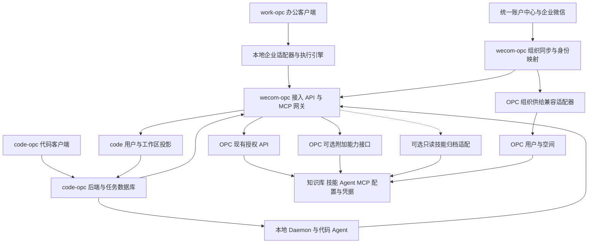
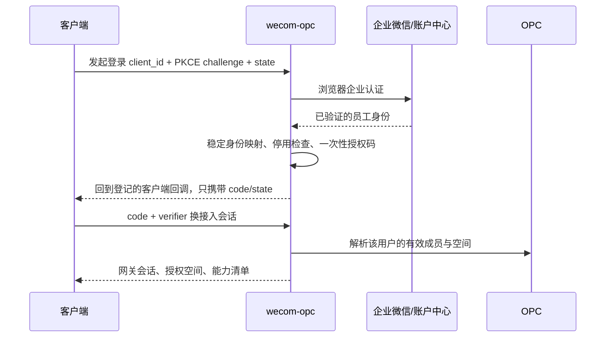

# OPC 统一云端、双客户端与组织集成技术方案 v2

日期：2026-10-19。版本：v2，整合多份方案评审与追加源码核查。状态：可用于实施拆解的设计稿，尚未实施、联调或部署。服务器信息为本会话前期只读勘察快照，本次文档更新未重新登录服务器。

## 1. 推荐决策

采用 **OPC 2.0 统一管理企业资源，wecom-opc 承担组织、身份和接入适配，work-opc 与 code-opc 保留各自执行引擎** 的架构。

- **work-opc**：办公客户端，处理本地文件、办公任务和交互审批。
- **code-opc**：代码客户端，保留 Multica 的任务、项目、Git、后端和 Daemon，负责代码执行。
- **OPC 2.0**：知识库、技能目录与安装、云端 Agent、MCP 服务与凭据、用户和空间权限的管理中心。
- **wecom-opc**：在现有企业微信、统一账户中心同步服务上扩展统一接入网关；集中处理身份映射、组织变更、客户端会话、协议转换与审计。

管理员继续在 OPC 配置知识、技能、MCP 和空间权限。客户端显示授权后的投影；网关不再建设一套可以独立修改这些资源的管理后台。组织同步规则、接入设备、同步异常等集成运维配置仍归 wecom-opc。

**实施原则是 OPC 零源码改动优先，先验证接口能力，再决定扩展方式：**

1. 第一批交付使用现有 API，完成个人登录、空间、双端知识检索及撤权。随后接通用户身份下的 OPC Agent 云端委托。
2. 本地技能分发先验证网关只读获取原始归档的路线；客户端只访问网关的授权分发接口。若采用此路线，明确接受 OPC 存储引用/schema 的版本适配成本，不把它称为零耦合。
3. 精确 MCP 调用与本地技能仍有无法覆盖的能力时，再验证第 14 节的薄扩展方案。薄扩展是候选方案，不是首期实施前提；不提前承诺现有 API 已能完成全部目标。

严格不改 OPC 源码时，可交付个人权限下的知识检索、通过验证的技能归档分发和云端 Agent 委托。后者不能等价替代逐工具 RPC。默认不在侧车中复制 OPC 的凭据解密和 OAuth 刷新实现；它比只读技能存储适配的耦合范围更大。

### 1.1 v2 固定的实施边界

| 决策 | 约束 |
| --- | --- |
| 个人会话是客户端授权入口 | 空间 endpoint Token 留在服务端；删除员工 membership 不会自动撤销该 Token |
| OPC 技能目录继续作为管理源 | catalog 列表/文件预览不等于完整包下载；原始包分发先做原型 |
| 保留母空间配置广播 | 技能发布、部门授权/投影、云沙箱安装分开建模，不默认向所有沙箱安装所有技能 |
| 统一账户中心是组织权威来源 | 企微事件触发权威查询，不能仅凭企微侧缺失判定离职 |
| 管理鉴权先于公网开放 | 全局广播需要系统管理员/明确运维权限，不能接受任意部门 Admin |
| 首期控制范围 | 一个试点部门、两类角色、两套客户端各一个执行路径；完整设备管理和全部 CLI 后置 |

## 2. 勘察基线与证据边界

### 2.1 本地项目

| 项目 | 本次基线 | 已确认的架构事实 |
| --- | --- | --- |
| work-opc | `5bf0d2fb8c72`，OpenWorker 0.3.4 | Python Agent/FastAPI，本地技能与 MCP；React/Tauri 桌面端 |
| code-opc | `2f247cc92f0c`，桌面包 0.6.3 | Multica fork；Electron、Go 后端、PostgreSQL、独立执行 Daemon |
| OPC-2.0 | `58b14903b654`，VERSION 0.8.3 | WeKnora fork；Go/Gin、Vue，已有租户 RBAC、RAG、技能、Agent、MCP |
| wecom-opc | 本地目录未包含 `.git` | Go/Gin；账户中心组织同步、企微登录、直接适配 OPC 数据表；本地新增沙箱同步相关实现 |

版本来自所读源码，不代表上游最新版本。work-opc 的 `.codegraph/` 为已有未跟踪目录，不纳入方案交付。

### 2.2 服务器现状

本次通过 `tokendance-test-ssh` 只读查看了 `10.101.102.116`。用户提到的 `ssh-tokendance-connect` 未在已安装技能中找到，使用现有同目标服务器的连接技能完成勘察。

| 对象 | 本次实际观察 |
| --- | --- |
| 当前 OPC Compose | `/data/OPC-2.0/docker-compose.yml`，不能沿用旧记录中的 `/data/WeKnora` 当作运行目录 |
| 当前服务器源码 | HEAD `5f161cfaa7dbb260fdb3dbe27bdba8867edb1b7a`，VERSION 0.8.3，存在提示词及 Dockerfile 的本地修改 |
| OPC App | `WeKnora-app`，宿主机 `3001 → 8080`；镜像 ID `sha256:7747115da0846f8cd13558b04b54a74f22e2df7c22433269e7b9a6b9f8a14937` |
| OPC Web | `WeKnora-frontend`，`3003 → 80`；镜像 ID `sha256:a35500ecfb7d067a638c25b2d4910c9e4af2d12512bd94816b6196a69a35931e` |
| 已部署接入服务 | `weknora-gateway`，端口 3002；Compose 位于 `/data/weknora-tokendance/docker-compose.yaml`，挂载同目录的网关二进制 |
| API 转发 | OPC 前端 Nginx 将 `/api/`、`/mcp/` 等转至 App；公网入口为 `admin.tokendance.sh` |
| 健康证据 | 公网首页 200，受保护 system/info 未登录返回 401，App 与网关健康接口返回成功 |

服务器网关源码与 wecom-opc 属于同一套 `weknora-tokendance` 结构，但本地新增的沙箱管理路由未出现在本次读取的服务器 main.go 中。**不能认定本地目录就是部署二进制的准确版本。** App 镜像没有可用的 revision 标签，源代码 SHA、VERSION、镜像 ID 三者不能互相替代。

本次没有使用业务账号验证登录、授权资源、技能下载或工具执行，没有读取配置密钥，没有变更服务器。网关公网路由及外部访问控制未完整核实；健康检查不构成端到端通过。

### 2.3 追加核查与待验证信息

- `wecom-opc/go.mod` 中的 `v5.3.1` 是 `github.com/golang-jwt/jwt/v5` 的依赖版本，不能据此标记网关发布版本。实际版本应由构建 SHA、二进制校验值与镜像记录确定。
- 现有源码确有技能 catalog REST API；Nginx 专用 location 或上传大小放宽只能说明代理规则，不能证明普通员工可下载完整原始包。第 9 节给出已核查的内容限制。
- 所读 OPC 前端代理配置未发现 `/wecom/` 专用转发。补公网入口是实施项；不能假定 `https://admin.tokendance.sh:3002` 已可访问，也不能据此排除所有其他公网入口。
- “63+ 部门正在使用”“OpenBao 已可直接接入”等信息作为部署盘点线索，本轮未做独立核验，不用于承诺容量、上线状态或密钥迁移条件。
- 追加源码核查确认企微 HTTP 客户端关闭了 TLS 证书校验、事件 POST 回调仅返回 success，纳入 P0/P2。

## 3. 目标架构与所有权



图中的只读归档适配与附加接口都是待原型验证的候选路径，第一阶段不依赖它们。组织供给适配器优先调用可用的管理 API，仍缺失的能力封装当前数据库兼容实现。

| 数据/动作 | 权威来源 | 其他系统保留的内容 |
| --- | --- | --- |
| 员工稳定身份、部门、在职状态 | 统一账户中心；企微作为登录与事件来源 | wecom-opc 保存跨系统稳定 ID 映射 |
| OPC 用户、空间、有效成员角色 | OPC；组织托管部分由同步器更新 | 网关短时缓存；code 保存受管投影 |
| 知识、索引、解析、文档权限 | OPC | 客户端按需获取片段与引用，不复制向量库 |
| 企业技能、云端安装与 Agent 绑定 | OPC | 已授权技能的版本化本地执行缓存 |
| MCP 定义、服务密钥、个人 OAuth | OPC | 客户端只持网关地址、工具描述、受限运行授权 |
| 办公会话、本地文件访问许可 | work-opc | 网关仅记录必要的云资源访问审计 |
| 代码任务、Git 工作区、Daemon | code-opc | 网关只保留外部 ID、授权和关联审计 |
| 本地执行审批 | 各客户端/Daemon | OPC 角色不能自动授予本地文件或 shell 权限 |

云端是企业配置的唯一管理入口，但本地确实执行技能时，必要的技能字节会缓存到设备。这是受控分发，不是新增一个独立技能管理源。

## 4. 当前接口可复用程度

| 能力 | 当前 OPC 能力 | 设计判断 |
| --- | --- | --- |
| 当前用户、空间与角色 | `/api/v1/auth/me`、`/auth/switch-tenant`、`/auth/refresh`、`/tenants` | 可复用；网关仍须绑定用户和当前空间 |
| 知识检索 | `/api/v1/knowledge-search`、`/knowledge-bases/:id/hybrid-search` | 可复用，保留服务端 ACL 与检索策略 |
| 文档与引用 | knowledge 元数据、chunks、preview 等路由 | 按原有权限代理；下载与预览权限并不相同 |
| 云端智能体执行 | `/sessions`、`/agent-chat/:session_id`，审批、OAuth 处理及 stop 接口 | 可复用，但需要事件流、审批、取消状态机 |
| 技能清单 | `/skills`、`/skills/catalog` | 可展示；`/skills` 依赖沙箱/Agent 上下文，不能视为全租户技能目录 |
| 普通成员下载完整技能包 | catalog 文件浏览/内容接口要求 Admin；内容会截断大文本，部分二进制仅返回元信息；未发现普通主体的通用 bundle 接口 | 不能用预览接口无损重建任意包；验证原始归档适配或薄扩展，凭据留在服务端 |
| MCP 配置和工具信息 | `/mcp-services` 及 tools/metadata 等 | 可读取权限允许的描述；低权限响应会剔除敏感配置 |
| 按个人身份精确调用 OPC 配置的 MCP 工具 | 内部 `MCPCallTool` 存在；未发现公开通用 `tools/call` HTTP API | 完整模式需要新增运行接口 |
| OPC 原生入站 MCP | `/mcp/:endpoint_id` | 是 OPC 知识能力的对外入口，使用端点 Token 的独立主体；不等同于用户登录，也不是所有出站 MCP 的代理 |
| 原生 MCP `ask` | `default_agent_id` 选择允许的 Agent，内部可进入 AgentQA/KnowledgeQA | 可作为端点身份下的云端委托；不是个人 OAuth/审批/精确工具代理已打通的证据 |
| 任意集成配置存储 | `/tenants/kv/:key` 仅接受固定白名单 | 不可把任意 manifest、会话或映射塞入该接口 |

**“配置了 MCP”有两种不同方向：** OPC 调用外部 MCP 服务，以及外部客户端调用 OPC 的知识 MCP 端点。双客户端需要的主要是第一种的用户级代理能力，不能直接拿第二种的共享 Token 冒充个人授权。

## 5. wecom-opc 的改造范围

### 5.1 在现有服务中形成清晰模块

建议保留项目名称和现有运维入口，按职责拆分：

```text
wecom-opc/
  internal/identity/          企业身份映射、登录交换、设备会话
  internal/organization/      快照、成员差异、停用与调岗
  internal/opcclient/         现有 OPC API 客户端
  internal/opccompat/         必要的 OPC 表结构兼容逻辑
  internal/integrationapi/    双客户端统一 API 与能力协商
  internal/mcpgateway/        MCP 协议、运行授权、事件桥接
  internal/codeprojection/    code 用户和工作区投影
  internal/audit/             同步与资源访问审计
```

这是建议的新目录，不是当前已有代码。先提取适配边界，再逐步迁移现有 `pkg/*`，无需一次性重写。

接入数据使用独立数据库/独立 schema 与迁移用户；OPC 兼容连接使用单独、最小权限数据库账号。当前 `AutoMigrate` 会在 OPC 库创建部门映射表，迁移时先复制和校验映射，再切读写，保留旧表用于回退，不能直接删表或重建 ID。

### 5.2 进入双客户端试点前必须处理的现有缺口

| 证据 | 当前影响 | 改造要求 |
| --- | --- | --- |
| `main.go` 的 `/admin/api`、`/wecom/sync` 未挂鉴权，所读 admin handler 也未做角色检查 | 应用层自身不足以保护管理操作；公网是否另有保护尚未确认 | 服务内认证、系统管理员授权、写操作 CSRF/来源校验、审计；不能只依赖端口不公开 |
| `handler.go` 的 OIDC Token 为随机 UUID，userinfo 固定返回同一用户 | 是占位接口，不能用于标准联邦登录 | 删除对“已支持完整 OIDC”的假设；新建可靠的原生客户端授权码交换 |
| `storage.go` 用 email 或 username 寻找用户 | 同名、改邮箱可能误合并身份 | 建立 `(issuer, external_subject) → opc_user_id` 唯一映射；存量冲突单独处置 |
| `EnsureTenantMembership` 对已存在成员直接返回 | 主管变更、降权不会更新已有角色 | 区分同步托管授权与手工授权，进行可审计的差异同步 |
| 停用用户在 `SyncUserAndMemberships` 中直接跳过；部门同步以新增/更新为主 | 不能据此证明离职、调岗旧权限被撤销 | 增加停用、移出旧空间、会话/任务撤销流程 |
| `IssueWeKnoraTokens` 持共享 JWT 密钥并直接写 `auth_tokens` | 与 OPC 内部格式和表结构耦合，两个 Token 写入非单一事务 | 暂时封装为 LegacyAuthAdapter；事务、校验、回收、版本测试，禁止密钥离开服务器 |
| 企微客户端设置 `InsecureSkipVerify: true` | 无法可靠验证远端证书 | 恢复 TLS 校验；如有企业代理，配置明确的受信 CA，不保留关闭校验的回退 |
| `HandleEventCallback` 仅回复 success | 事件不会驱动组织变更落地 | 实现签名/解密、重放保护、持久队列与权威查询，完整性通过后执行差异同步 |

这些是本次代码勘察发现的接入前提，不是对公网可利用性的完整安全审计结论。

### 5.3 保留现有组织和空间语义

当前组织来源实为统一账户中心 GraphQL；不是简单地把所有企微部门都建成空间。代码选择 `DepartmentLevel == 1` 的部门建空间，员工子部门映射至相应上级目标部门。

第一阶段保持该规则和已有 tenant ID，避免拆散现有知识、Agent 和权限。后续允许管理员在同步控制台调整“哪些部门形成空间”，采用预演后迁移。现有 `20000 + 部门数值 ID` 仅用于兼容历史 ID；新建时使用显式映射、冲突检查和受控分配，不能继续默认永不冲突。

当前还有母空间向部门空间同步模型、存储、沙箱的逻辑。继续保留，并遵守已有沙箱设计：**更新配置保留子空间 sandbox ID 和扩展字段，不替换已有 Agent 引用**。同步必须支持托管字段范围、覆盖预览和人工例外，防止全量广播抹掉部门定制。

当前普通员工会加入公共母空间并获得 Contributor。上线前应审查该空间的实际内容和用途：公共资料空间、全局配置管理权限要分清。不要仅凭“母空间”名称推断所有员工应有写权限，也不要未经迁移直接改变现有成员角色。

### 5.4 网关改造优先级

| 档次 | 内容 | 完成条件 |
| --- | --- | --- |
| 首次接入前 | 建立 Git 和发布基线；管理认证授权；TLS；密钥注入；最小数据库/JWT 契约测试 | 未授权和部门 Admin 均不能执行全局管理；已确认运行来源与回退方式，才能开放入口 |
| 组织治理闭环 | 事件驱动权威查询；完整快照对账；降权/离职；持久同步记录、重试与告警 | 异常快照不批量清权；有效变更能传播到 OPC、code 和运行租约 |
| 渐进解耦 | store 抽接口；已有管理 API 替代直写；映射策略配置化；移除占位接口和确认无调用的死代码 | 每条保留的 schema/Token 依赖有契约测试和版本声明 |

Git 基线先排除 `config.yaml`、密钥、运行数据和构建产物，使用脱敏配置模板；本次更新方案不执行 git init 或提交。首次基线不能只收本地源码，还需记录线上二进制校验值及与源码的对应关系。

母空间模型/存储/沙箱广播必须校验系统管理员或显式运维授权，部门 Admin 仅能管理自己的空间。管理写接口按实际 Cookie/Token 认证方式设置 CSRF 与来源保护。

密钥使用受限的部署注入机制；环境变量不是加密存储。可选择只读 secrets 文件或经验证的 OpenBao 注入，明确启动身份、最小读取权限、轮换与故障策略，禁止日志/诊断泄露。OpenBao 可用性未验证前，不将其设为唯一上线依赖。

租户 ID、层级筛选、邮箱兜底域名、角色映射逐步配置化；先固化当前规则和映射，再预演迁移。数据库兼容测试从第一次改造起就运行，不能留到最后“按需”建设。

## 6. 组织同步与权限模型

### 6.1 稳定身份与授权来源

核心键采用不可变 ID：`external_subject`、`opc_user_id`、`opc_tenant_id`、`code_user_id`、`code_workspace_id`。姓名、邮箱、部门路径都只用于展示与受控存量匹配。OPC 的 uint64 空间 ID 在跨语言 API 中使用十进制字符串。

OPC 是有效资源权限来源；组织平台是组织托管授权的来源。网关维护每笔同步授权的来源和上次值：

1. 新员工或入部门：创建稳定身份关联，增添对应空间成员。
2. 调岗：先算出新旧授权差异，再增加新空间；回收由组织同步授予的旧空间权限，保留有明确来源的手工授权。
3. 主管变更：撤回旧主管的组织托管 Admin，重新计算剩余授权；不能因早期角色已存在而永远保留 Admin。
4. 离职/停用：禁用企业登录，撤销网关与 code 会话、运行授权；同步 OPC 用户/成员停用并处理现有 OPC Token。
5. 部门停用：先禁止新任务和新分配，保留资源与审计；归档、移交、删除分开处理。

OPC 若只有单一成员角色字段，来源叠加与人工例外保存在网关，由单一同步写入器计算有效角色。遇到 OPC 人工修改与上一同步值不一致时标为冲突待处理，不能盲目覆盖，也不能无限保留已撤销的托管权限。

全量组织同步采用“读取完整分页快照 → 校验完整性 → 生成 diff → 执行 → 记录结果”。空响应、分页失败或异常大幅缩减不得触发批量移除。部门级失败汇总为部分失败，不能像当前循环一样仅记日志后整体成功。增量事件签名校验、去重，定期快照对账。

企微事件仅作为变化通知，处理链为“验签/解密 → 持久化并及时应答 → 查询统一账户中心 → 生成差异 → 幂等执行”。不把企微应用可见范围变化、短时缺失或单个删除事件直接解释为员工离职。必须确认账户中心能提供停用/离职状态或可靠完整快照，否则保持待核实状态。保留现有定时周期作为初始对账频率，事件延迟与定时周期分别监控。

同步状态从进程内存迁入持久记录，保存来源快照、受影响对象、步骤结果、重试次数和告警状态；使用任务锁避免 Cron、事件和人工广播并发覆盖。

### 6.2 code 工作区投影

初期使用 **一个 OPC 部门空间对应一个 code 企业工作区**；工作区下容纳多个代码项目。公共资料通过 OPC 已有共享权限读取，不为了读公共资料给用户增加所有代码工作区权限。

| OPC 有效角色 | code 企业工作区投影 | 限制 |
| --- | --- | --- |
| Owner/Admin | Admin；技术 Owner 由系统受控管理 | 不授予 code 平台全局管理员 |
| Contributor | Member | 云资源与具体任务仍需能力检查 |
| Viewer | 显式只读能力 | 当前原生角色不足时需补服务端只读约束，不能直接映射成可执行 Member |
| 无成员/已停用 | 无访问权限 | 撤销相关会话、订阅、任务租约与云工具授权 |

Git 仓库授权独立存在：能进入 OPC 空间不代表能 clone、push 该空间所有仓库。仓库访问继续由 Git 平台与 code 项目配置控制。

默认只展示已映射的企业工作区。OPC 删除/停用空间时，code 先冻结并归档投影，不级联删除代码和任务。

## 7. 统一登录、会话与撤权

### 7.1 双客户端登录流程



原生客户端采用系统浏览器、PKCE、随机 state、一次性授权码、短有效期和严格 callback allowlist。回环回调仅监听 `127.0.0.1`；允许的随机端口需按客户端注册规则验证。不得沿用把 access/refresh Token 放进 URL fragment 的旧桌面跳转方式。

桌面端持有网关自己的短期 access Token；refresh 凭据进入 OS Keychain/DPAPI 等系统凭据存储。网关 access 的 audience 与 OPC JWT、code JWT、Daemon Token 各自独立，不能共享签名密钥或跨系统直接接受。

第一阶段服务端可以复用现有身份与 OPC Token 兼容桥，但必须把 Token 留在网关的加密存储，逐用户关联，按 OPC 当前状态校验，退出和停用时回收。新增 native 会话表保存 refresh 的哈希、轮换链、设备与撤销时间，不能仅依赖 JWT 的 exp。

OPC 原生 OIDC 可以成为后续去掉共享签名密钥的路线，但本地 `LoginWithOIDC` 当前按 **email 查询账号**，并非完整的 `(issuer, sub)` 账号绑定。不能只实现 wecom 的 OIDC 端点就宣布身份迁移完成；需另行验证账号绑定/迁移策略，必要时提出独立上游兼容修复。这不阻塞第一阶段使用受限的 LegacyAuthAdapter。

### 7.2 code 的身份兑换

code 后端新增专用 federation exchange，以一次性、指定 audience 的授权兑换 code 自己的会话。投影用户以稳定 OPC ID 关联，禁止沿用 OAuth 流程的“邮箱相同自动合并”。现有账号迁移需要显式、可审计的绑定。

code 的原生会话是无服务端 session 的滑动 JWT，原生退出主要清 Cookie。因此必须增补企业 session ID/epoch 与校验机制，覆盖 HTTP、WebSocket、PAT、Daemon 领取任务、任务 Token 和刷新入口。只改登录页会留下旧 Token 长期有效的问题。

Daemon 的注册凭据只证明“是哪台执行器”，不能证明当前员工还有某空间权限。每次任务领取由 code 后端请求网关签发绑定 `user/tenant/workspace/task/device` 的运行授权，定期续租；任务结束立即撤销。

### 7.3 权限生效边界

每次云端调用：认证会话 → 校验当前成员 → 校验资源归属与共享 → 校验执行档案/Agent 绑定 → 校验动作权限 → 审批 → 执行。

建议初始目标：网关已接收并应用停用/权限变更后，60 秒内停止新的云调用和运行授权续租；写操作执行前强制刷新授权状态。此指标不包含上游尚未送达的组织事件延迟；上游拉取/回调延迟另行监控。

审批权限仅授予真实用户交互会话，Agent 的运行 Token 不能批准自己的待审批动作。权限版本变化后，缓存和长连接需要失效；服务不可达时企业写动作失败关闭，不能回退管理员凭据。

本地已读取的知识或技能内容无法靠云撤权彻底“收回”。企业模式默认不新增离线云资源使用；撤权清理受管缓存，终止相关云连接，尽力停止受管任务。严格的终端数据控制还需要企业设备策略，不能通过服务端 RBAC 保证。

### 7.4 空间 MCP Token 的专门约束

空间 endpoint 使用独立机器主体，员工 membership 变更不会使其 Token 自动失效。默认不向员工下发共享 endpoint Token；work/code 持有个人网关会话或任务授权。

如网关使用端点作为上游，必须限制到预先批准的共享资源范围，并在每次调用检查个人授权。对于同空间内存在不同个人可见范围的知识，采用用户身份的 REST 检索，不能仅检查部门成员资格后直接代理整个端点。

历史上已下发的共享 Token 需要单独盘点、撤销/轮换并迁移客户端；轮换会影响同端点其他使用者，不视为个人撤权的替代。知识试点的最低验收包含“旧客户端凭据在撤权后不能继续云端访问”，不是只验证登录成功。

## 8. 知识库接入

统一暴露 `knowledge.search`、`knowledge.read` 两类工具。网关使用该用户在所选 OPC 空间的身份代理现有接口，不用全局管理员 APIKey 执行搜索。

搜索结果标准化为：`knowledge_id`、`chunk_id`、`knowledge_base_id`、标题、片段、来源、引用定位及来源空间。默认复用 OPC 的召回/重排配置；不在两个客户端各实现一套检索策略。工具参数中的 KB ID、文档 ID、共享来源都再次由服务端授权，不能信任模型或客户端传入。

`knowledge.read` 优先调用预览/片段接口。OPC 下载路由当前要求高于普通 Viewer 的权限，不能把客户端“打开原文”统一转换成下载接口，也不能通过服务器下载再转发绕过限制。

work 在会话内提供空间/知识源选择；code 在任务执行档案中绑定可用知识源。引用点击打开受控代理或 OPC 页面，不直接暴露私有 MinIO 地址。代码仓库或本地办公文件上传云端作为附件是单独操作，默认不自动上传整个工作目录。

## 9. 技能接入：统一配置，明确执行位置

### 9.1 两种交付模式

| 模式 | 执行位置 | 第一阶段可行性 | 适用场景 |
| --- | --- | --- | --- |
| 云端委托 `cloud_agent` | OPC Agent 及其沙箱 | 使用现有 session/agent-chat API；需绑定已授权 Agent | 内部知识、需要云凭据/云环境的技能 |
| 本地受管 `local_instruction/local_sandbox` | work 引擎或 code Daemon | 先验证原始归档读取和网关分发；必要时再做薄扩展 | 本地文件、代码修改、需要本机工具的技能 |

云端委托会再经过 OPC Agent 决策，可能增加一次模型调用，并不保证精确执行一个指定底层工具。界面应显示“交给云端助手处理”及执行进度，不能把它伪装成确定性的本地函数调用。

企业技能仍上传、安装、关联在 OPC。执行位置、允许导出等最小发布元数据可随技能包的独立 manifest 保存，例如 `opc-client.json`；网关解析它，不要求 OPC 新增通用 KV。该文件是否会被当前上传/归档链完整保留属于 P3 的验证项，未声明或无法验证时默认只能云执行。

建议发布清单字段：稳定技能 ID、目录 ID、版本、内容 SHA-256、执行模式、适用客户端、依赖、允许的工具类别、最低客户端版本。内容哈希由服务端实际包字节计算，不能信任包作者自报。技能的“允许工具”只是申请，不能超过用户/空间/运行档案的授权。

### 9.2 完整包分发契约

网关返回授权 manifest，客户端按固定版本下载；完整包包含 `SKILL.md`、scripts、references、assets，不能只同步 name/description 或单个 SKILL.md。与云端 Agent 配套的分发绑定其实际安装/绑定版本，避免目录最新版与运行版不一致；纯本地技能使用明确发布版本与导出授权，不为获得包而强制安装到云沙箱。

版本不可变，下载完成后校验大小、文件数、压缩比、路径、哈希；拒绝 ZIP 越界、符号链接逃逸及覆盖任意工作区文件。原子安装到账号和空间隔离的受管缓存。运行中固定版本，新运行用新版本；下架后禁止新授权，已有运行按撤权策略处理。

命名使用 `opc/<tenant>/<skill-id>` 作为内部稳定标识，显示名称另存。由于两个客户端的 SKILL.md 解析方式不同，不能依赖名称或目录优先级解决冲突；生成各客户端适配元数据，明确映射到已授权版本。禁止个人同名技能静默遮蔽企业技能。

云沙箱的脚本、路径、环境变量和凭据不一定适合本机。第一批本地技能只支持说明型和明确声明、验证过的本机依赖；其他技能继续云执行。企业 MCP 密钥、模型密钥、企微凭据不得随包分发。

### 9.3 原始包获取的候选路线

`/skills/catalog/:id/files/content` 面向文件查看：大文本可能截断，部分二进制只返回元信息，不能遍历它来宣称已实现无损 ZIP 下载。Nginx 的 location 和 body 大小配置不改变这些后端语义。

| 路线 | OPC 源码改动 | 实施条件与维护成本 |
| --- | --- | --- |
| 经验证的原生完整归档 API | 无 | 如果实际部署存在该接口，验证完整字节、角色权限、共享范围和版本后优先复用；当前未证实 |
| 网关只读原始归档适配 | 无 | 使用受限存储访问与版本化元数据适配，核对 catalog/安装快照、租户归属、归档引用及 SHA；承担 schema/存储契约维护 |
| OPC 薄导出接口 | 有，窄范围 | 在 OPC 内复用存储与权限服务，见第 14 节；承担源码注册和服务调用适配维护 |

三条路线对客户端输出同一授权分发契约。网关只读适配中，客户端不得指定存储 key/URL，不能获得数据库或 MinIO 凭据；只能请求稳定技能 ID 和已发布版本。普通成员可见目录不自动等于允许导出，必须有显式发布策略并验证当前用户与空间授权；权限映射无法可靠验证时拒绝分发。

原型至少包含文本脚本、较大文本、二进制附件和嵌套目录，对原始归档与下载结果做哈希及文件清单核对。只读适配无法安全实现时关闭本地分发能力，保留云委托，再评估薄扩展；不能用管理员 Token 下发客户端补洞。

### 9.4 母空间技能发布与部门投影

保留现有母空间广播的运维入口，但新增技能资源类型时建立独立发布任务：源 catalog ID/版本/哈希、目标空间、目标 catalog ID、安装目标、同步状态、上一成功版本及下架策略。

1. 管理员在 OPC 发布源技能；通过已存在的共享授权机制或显式导出/目标空间发布策略确定目标。不得仅因“属于母空间”就默认允许所有部门复制。
2. 优先复用已验证的共享目录能力；确需部门副本时，用 catalog 注册 API 上传同一已校验归档并记录 ID 映射，按源 ID＋版本＋目标空间幂等执行。
3. 客户端本地执行只需获授权的发布包。只有确需 OPC 云端执行的目标 Agent，才触发相应沙箱安装；不自动给全部部门沙箱烘焙全部技能。
4. 发布任务记录部分失败、重试和版本漂移；源技能下架先停止新授权，显式处理部门副本与安装，不能把“源目录删除”当成已完成全部回收。
5. work 使用账号/空间隔离的受管目录，code 接任务级技能 resolver；全局技能目录仅保留个人用途，不作为企业同步默认目标。

原始包读取、目标注册、安装、授权分发是四个不同步骤，必须分别验证。现有模型/存储/沙箱广播的成功经验不能代替这条管线的端到端测试。

## 10. MCP 接入与云端审批

### 10.1 统一 MCP 网关

两个客户端只注册一个企业连接 `opc-cloud`。网关根据当前用户、空间及运行档案提供工具列表，保留 OPC 服务 ID/工具名映射，使用稳定前缀解决同名工具冲突。

本地适配器可采用 stdio bridge：子进程持有短时运行授权并连接网关，按需续租，避免把长期 refresh Token 写入 MCP 配置。HTTP 客户端也可以使用支持轮换的 Token 提供器；不能把一次性静态 Authorization header 当作完整续期方案。

第一阶段该连接提供知识工具和“云端 Agent 委托”工具。精确代理阶段增加 `tools/list`、`tools/call`、必要的 resources/prompts 支持；工具声明必须准确区分副作用。客户端自己配置的本地 MCP 在个人模式单独存在；企业严格模式以受管清单为准。

### 10.1.1 两种云端委托入口

推荐通过用户身份的 `/sessions`、`/agent-chat/:session_id` 接入，以便衔接个人权限及第 10.3 节的事件/审批流程。

OPC 原生 MCP 的 `ask + default_agent_id` 也有真实实现：选择端点允许的 Agent，进入 AgentQA 或 KnowledgeQA，同步返回答案和引用。它适合预先批准的端点级共享问答，但使用端点主体，会话也归端点所有。不能把员工 JWT 直接替换成端点 Token 后仍声称保留了个人 OAuth、个人会话隔离和审批能力。

使用 `ask` 路线前分别验证：允许的 Agent、实际可用工具、凭据主体、知识范围、交互审批、OAuth 恢复、超时和取消。默认只启用已通过测试的共享问答；涉及个人凭据或写动作时，不支持的能力明确不可用。两种入口都属于模型驱动的云端委托，不承诺指定底层工具的确定性调用。

### 10.2 精确调用路径

需要精确工具调用时，推荐验证的候选路径为：本地 Agent → 网关运行授权校验 → OPC 附加调用接口 → OPC 既有 MCP runtime → 外部 MCP。这样复用 OPC 的 per-user OAuth、凭据解析、连接管理、工具批准和租户授权。此路线未通过原型前，`mcp_exact_call` 保持关闭；云委托可独立交付。

**不要在 wecom-opc 中默认复制一套凭据解密和 OAuth 刷新实现。** 外部侧车无法仅靠当前 `/mcp-services` 的脱敏响应恢复完整调用上下文。

云端 stdio MCP 仍在服务器执行；不把服务器 command/env 下发到员工电脑。确实必须本机运行的 MCP 是单独的受管本地能力，需声明依赖和权限，不能等同为“同步 OPC 配置即能运行”。

### 10.3 审批、OAuth、取消与重试

网关统一状态：`running`、`waiting_approval`、`waiting_oauth`、`succeeded`、`failed`、`cancelled`、`unknown_outcome`。已有云 Agent 流程映射 OPC 的审批与 OAuth resolution 接口；精确调用扩展也必须有相同语义。

审批绑定用户、空间、运行 ID、工具、参数摘要和有效期。浏览器完成 OAuth 后服务器刷新授权上下文，再恢复调用；OAuth Token 留在 OPC。断线重连只能恢复已授权运行的事件，不跨账号复用 pending ID。

写工具超时不能自动重试。网关记录 idempotency key 与调用状态，但外部工具没有幂等支持时无法承诺 exactly-once；标记结果未知并要求核对外部结果。取消只承诺发送停止并终止后续步骤，不能回滚已完成的外部副作用。

## 11. work-opc 改造落点

| 代码位置 | 改造内容 |
| --- | --- |
| `surfaces/gui` 与桌面宿主 | 企业登录、账号/空间切换、资源目录、云执行与审批状态 |
| `coworker/server/run.py`、`app.py`、`manager.py` | 注入企业会话上下文；校验本地请求归属；切换身份时销毁旧 runtime 和连接 |
| `coworker/agent.py` 的 `build_engine` | 用 `extra_tools` 注入知识/云委托工具，用 `extra_skill_dirs` 与 `skill_filter` 注入受管技能 |
| `coworker/skills/base.py`、`store.py` | 增加云资源标识与版本缓存适配；保留个人技能并明确模式与来源 |
| `coworker/mcp/client.py`、`config.py` | 新增企业 MCP bridge；会话和连接缓存按身份/空间/运行隔离 |
| `coworker/secrets.py` 的调用边界 | 企业 refresh 使用系统凭据库，新建专用适配器 |
| `coworker/sessions.py` 及持久层 | 保存权威企业身份、空间、执行档案，加载会话时重新校验 |

当前 `SessionManager(data_dir=...)` 不足以隔离账号：其 SecretStore、MCPManager、SkillStore 存在全局默认构造。应显式依赖注入，统一隔离键至少为 `gateway_origin + opc_user_id + tenant_id`；任务连接再加 run ID。MCP 连接缓存当前以 server.name 为键，也需调整。

现有 SecretStore 是权限 0600 的 JSON 文件，不能当成已实现的系统安全凭据库。企业 Token 不写到该文件、会话日志或发给模型的工具参数。

保留 work 现有 PermissionEngine、reviewer 和本机沙箱。有效执行权限是“云授权 ∩ 受管执行策略 ∩ 本机许可”，空间 Admin 也不能绕过本地文件授权。原 Auth0 云连接功能是另一身份域，企业模式需要显式配置入口，不能简单替换常量 URL。

## 12. code-opc 改造落点

code-opc 不只是桌面壳。推荐保留并部署自己的 Go 服务与数据库，与 OPC 并列运行；桌面 API/WS 地址指向 code 后端，不能直接指向 OPC API。

| 代码位置 | 改造内容 |
| --- | --- |
| `apps/desktop/src/main/runtime-config-loader.ts` | 企业部署地址与登录回调配置；系统凭据桥接放 Electron 主进程 |
| `packages/core/` | 接入 API schema、账号/空间资源查询、按工作区隔离的 Query key |
| `packages/views/` | 共享登录/资源选择/云审批 UI；遵守现有平台适配边界 |
| `server/internal/handler/auth.go`、`middleware/auth.go`、`auth/session.go` | federation exchange、稳定身份关联、企业撤权校验 |
| code 自有迁移和 repository 层 | external identity、受管 workspace、federated session、运行授权引用 |
| `server/internal/handler/daemon.go` | 领取任务时生成受限授权；使用 OPC 技能版本；完成/失败/取消回收 |
| `workspace_mcp_api.go`、`mcp_overlay.go` | 企业 MCP 描述投影、任务级 `opc-cloud` overlay；不向普通 API 暴露凭据 |
| `server/pkg/agent/*` | 每种 CLI 的受管 MCP、技能注入及执行限制适配 |

现有任务下发已有 `ResolveAgentMcpConfig`、运行 overlay、`LoadAgentSkillBundles`/`ResolveTaskSkillBundles`，应在这些入口增加 OPC resolver，避免绕开任务授权另建全局技能同步程序。

该项目 `mcp_config` 的 `null` 表示继承机器配置，`{}` 表示受管空配置。企业配置读取失败时必须拒绝或传受管空配置，不能回退为 `null`，否则会意外启用机器上的全部 MCP。

仅安装一个 UI 插件不足以覆盖登录、Daemon 授权和 Token 撤销。插件可用于局部资源展示，但当前宿主是否支持具体挂载点需另行验证，不能把 manifest 中出现的常量当作已可用能力。

执行安全按 CLI 分别验收：当前 Claude 启动参数包含 `--permission-mode bypassPermissions`，不能宣称云端角色能自动带来本地交互审批。需要 Daemon 的受管目录/命令/网络策略、隔离环境，以及云工具网关独立审批。每种 CLI 都要覆盖权限模式与沙箱参数测试，不默认所有 Agent 一致。

## 13. 新增接入 API 草案

以下为 **wecom-opc 待实现契约**，均不是现有 OPC 路由。统一前缀 `/integration/v1`，只暴露具体业务能力，不提供任意 URL/SQL/命令代理。

| 方法与路径 | 含义 |
| --- | --- |
| `GET /capabilities` | 协议版本、已启用功能、兼容状态与最低客户端版本 |
| `POST /auth/start`、`POST /auth/exchange` | PKCE 登录事务与一次性 code 兑换 |
| `POST /auth/refresh`、`POST /auth/logout` | refresh 轮换、设备/全账号退出 |
| `GET /me`、`GET /spaces` | 当前身份和有效空间投影 |
| `POST /spaces/:id/select` | 校验并签发该空间的上下文；不接受任意 tenant header 覆盖授权 |
| `GET /spaces/:id/resources` | 可用知识源、Agent、技能、MCP 描述与资源版本 |
| `POST /knowledge/search`、`GET /knowledge/:id/preview` | 授权知识工具 |
| `POST /runs`、`GET /runs/:id/events`、`POST /runs/:id/cancel` | 云委托/受管任务、SSE 恢复与取消 |
| `POST /runs/:id/approvals/:approval_id` | 真实用户的云工具审批 |
| `POST /runtime/grants`、`POST /runtime/grants/:id/renew` | 受限运行授权；供已认证 work runtime/code 后端使用 |
| `GET /skills/:id/versions/:version/manifest`、`GET /skills/:id/versions/:version/bundle` | P3 完整包分发；每次验证授权和内容哈希 |
| `POST/GET/DELETE /mcp` | Streamable HTTP MCP 连接；会话 ID 不是授权凭据 |

私网另外提供 code 身份兑换/投影接口；要求服务端认证和一次性用户授权证明，不能只凭 `user_id` 请求代发用户 Token。

通用上下文包括：`subject`、`tenant_id`、`client_id`、`run_id`、`policy_version`、`request_id`。服务端从会话解析主体，不信任客户端自报。列表统一分页，错误包含稳定机器码，如 `ACCESS_REVOKED`、`SPACE_NOT_BOUND`、`CAPABILITY_UNAVAILABLE`、`APPROVAL_REQUIRED`、`UPSTREAM_INCOMPATIBLE`，不得在错误中回传凭据。

能力协商区分 `knowledge_search`、`cloud_agent_delegate`、`skill_bundle_export`、`mcp_exact_call`。只对完成授权和端到端验证的能力返回 true；技能包可由只读归档适配实现，不能仅凭“是否安装 OPC 补丁”判断。缺失能力时 UI 与 Agent 工具列表据此收缩，不能把接口 404 当成空配置后继续继承本机环境。

## 14. OPC 附加能力接口的候选边界

先验证公开 API 和第 9.3 节的只读归档适配；需要增加 OPC 源码能力时，独立维护薄扩展目录和可重放的注册补丁，优先向上游提交通用能力。技能导出与精确 MCP 分别决策，可以只实现其中一项。当前未确认存在可动态安装的服务端插件机制，因此不能承诺“放一个插件文件就能接入”。Go 的内部包边界也意味着外部进程不能直接导入现有 internal 服务来绕过编译集成。

### 14.1 技能运行包导出

新增示意接口 `GET /api/v1/integration/skills/:catalog_id/bundle`，配套 manifest：

- 使用现有用户认证、空间/共享 Agent 权限和实际技能绑定校验。
- 请求携带执行档案/Agent、版本和内容哈希，服务端确定真实授权上下文。
- 从既有目录/安装快照与存储服务读取完整包，限制导出策略和缓存行为。
- 返回稳定技能 ID、实际版本、内容哈希、文件大小及可验证包内容。
- 不开放目录遍历、不授予 catalog 管理权限、不返回 MinIO 管理凭据。

### 14.2 MCP 精确运行接口

新增示意接口 `POST /api/v1/integration/mcp/invocations`，以及状态/事件、审批与取消衔接：

- 接收具体 service ID、tool name、arguments、运行 ID 与幂等键；不接受上游 URL 或原始凭据。
- 在用户权限之外验证 Agent/执行档案绑定与工具白名单，防止任意客户端扩大调用范围。
- 在 OPC 内部复用现有 MCP runtime、用户 OAuth 与批准链；先做服务层抽取验证，不能仅调用未初始化上下文的 `Execute`。
- 返回结果或待审批/待 OAuth 状态；审批不能由执行 Token 自行完成。
- 如果内部实现无法安全分离成上述授权边界，停止该子功能并继续云委托模式，不能降级为管理员直连外部 MCP。

这两类接口不改知识索引、不改变既有身份与 RBAC 表结构、不要求改 OPC Web 主流程。仍要维护源码注册和内部服务适配成本；“薄”应由实际依赖数量和升级契约测试衡量，而不是承诺固定几行代码。

组织供给 API 和真正按 subject 绑定的 OIDC 是另两项可独立演进能力；它们不是上述两个接口自动解决的问题。第一阶段保留受约束的既有数据库兼容桥，后续逐项用上游管理 API 替代。

## 15. 数据、缓存与故障处理

wecom-opc 独立持久化建议：

| 表/集合 | 关键用途 |
| --- | --- |
| `external_identities` | issuer/subject 到 OPC、code 用户的唯一关联 |
| `space_bindings` | 部门到 OPC 空间、code 工作区映射及状态 |
| `managed_grants` | 组织同步授权来源、人工例外、上次有效值 |
| `sync_snapshots`、`sync_jobs` | 完整性、差异、部分失败与重试 |
| `client_sessions` | 设备、refresh 哈希/轮换链、撤销与权限 epoch |
| `upstream_sessions` | 服务端加密保存的逐用户 OPC 会话引用 |
| `runtime_grants`、`integration_runs` | 任务范围、租约、状态、审批关联与幂等结果 |
| `projection_outbox` | 向 code 同步的可靠事件与去重 |
| `resource_manifests`、`audit_events` | 可重建资源投影与必要审计 |

不得镜像整个 OPC 用户库、复制知识索引或把明文凭据写入审计。code 保留自己的业务数据库，只新增必要外部映射；新迁移遵循其仓库现有规则。

OPC 与 code 之间没有跨库事务。组织同步采用可重试步骤/outbox，权限撤销先在网关阻断，再更新 OPC 与 code，记录未完成部分。新增权限必须等待资源归属与投影确认后开放，避免部分成功导致越权。

缓存键至少含网关部署、用户、空间、授权版本；运行工具列表另加执行档案与运行 ID。切换空间时停止旧数据流，旧空间回包不得写入新空间缓存。默认不跨用户共享含私有结果的缓存。

OPC 不可达时：企业资源显示不可用，停止新云工具调用；本地已有任务是否继续只按预先声明的本地独立执行策略处理。code 后端与 OPC 的故障分别展示，不因知识服务不可达销毁代码任务。

## 16. 部署与跟随上游升级

### 16.1 部署形态

- OPC 继续使用现有 App/Web/存储与检索基础设施。
- wecom-opc 作为独立可版本化镜像部署；不再以不明构建来源的裸二进制挂载作为长期发布方式。
- 新增 code-opc 后端及独立数据库，桌面端连接该后端；本次未确认服务器已部署 code 后端，排期需包含此项。
- 网关与 code 服务只通过明确内部接口访问 OPC；客户端只访问 HTTPS 接入地址，不接触数据库、MinIO 管理口或 Docker socket。
- 优先独立接入域名和部署层入口，例如待配置的 `gw.tokendance.sh → localhost:3002` Cloudflare Tunnel ingress，避免改 OPC 前端镜像；也可用独立反向代理路径。域名、证书、回调 allowlist、SSE/MCP 长连接都需部署验证，以上域名不是已上线事实。
- 公网只开放明确的登录/回调/客户端 API；管理面单独保护。先完成第 5.4 节加固及未授权访问测试，再发布入口，不能先暴露 3002 后补鉴权。
- Compose overlay、入口路由、资源限制、备份脚本保存在集成部署目录，避免改 OPC 上游 Compose 主文件。

### 16.2 升级契约

每次 OPC 升级必须记录：上游/自有源码 SHA、附加补丁版本、镜像 ID 或 registry digest、配置版本、数据库迁移版本，以及通过的 API/兼容测试集。不能仅记录 VERSION 或 latest 标签。

优先以公开 API 适配。LegacyAuthAdapter、组织表适配、技能扩展、MCP 扩展分别做版本兼容模块，未知版本启动为不兼容状态并禁止写入。健康检查分存活、依赖可达、契约兼容，避免服务显示健康但同步实际破坏数据。

最小契约测试在 P0 建立，覆盖用户/空间/成员字段、Token 校验与撤销行为、跨空间权限。引入只读技能适配时追加存储引用、归档哈希与导出授权测试。兼容失败阻断相应写操作或分发，不仅报警后继续执行。不能以“OPC 源码没有改”推断数据库直写天然兼容升级。

发布流程：固定测试镜像 → 副本数据库验证迁移与适配 → 两类角色/两个空间契约测试 → 单部门灰度 → 扩大。每次上游变化只改适配边界，客户端面对的是稳定 `/integration/v1`。

回退以兼容路由/功能开关为主。P3 出问题时回退到 P2 云委托，不自动改成管理员绕行。数据库发生不可逆迁移后不能只换回旧镜像；需另行验证恢复流程。现有服务器的部署定制先归档对账，不能用拉取上游覆盖。

## 17. 实施分期与交付验收

先完成三个原型判定：A）个人身份与撤权能穿透双客户端；B）完整技能归档能够按权限无损分发；C）云委托的身份、审批和取消范围可验证。A 是首个业务版本的前置，B/C 可独立推进。失败项保持能力关闭，不能用共享 Token 或管理员身份绕过。

以下为规划估算，假设两名后端、一名客户端工程师并行、测试与运维可配合；不是基于已完成原型的工期承诺。首轮限定一个部门、Viewer/Contributor 两类角色、两端各一个执行路径，暂不覆盖完整设备控制和全部代码 CLI。

| 阶段 | 交付物 | 进入下一阶段的条件 | 粗估日历时间 |
| --- | --- | --- | --- |
| P0 基线与接入加固 | wecom Git/发布基线；管理鉴权；TLS/密钥；最小契约测试；测试账号；加固后才开放公网入口 | 未授权及部门 Admin 无法执行全局操作；身份映射、运行来源和回退明确 | 1–2 周 |
| P1 双端身份、空间与 RAG | 个人网关会话；code 身份/空间投影；知识工具与引用；原型 A | 两空间不可越权；换号不串缓存；撤权后旧会话、任务和订阅不能继续云访问 | 2–3 周 |
| P2 组织闭环与云委托 | 企微事件触发账户中心查询；完整快照对账；同步审计/重试；用户身份的云 Agent、审批与取消；原型 C | 调岗/降权/离职可回收；不完整快照不误删；真实用户才能审批 | 1–2 周 |
| P3a 本地技能分发 | 原型 B；选定原始包路线；母空间发布/部门投影；work 隔离缓存；code 任务级技能源 | 原始包字节完整；版本固定；普通用户不得越权导出；下架停止新授权 | 与 P3b 合计约 2–4 周，原型后重估 |
| P3b 精确 MCP 与执行适配 | 按需求验证薄接口；任务级 MCP overlay；逐 CLI 策略；保留云委托回退 | OAuth/审批/撤权闭环；超时不重复写；无服务器凭据落端 | 同上；可独立后置 |
| P4 灰度与升级演练 | 一部门试点、监控、备份/回退、一次 OPC 升级演练、运维文档 | 业务验收和兼容性基线通过，明确支持矩阵 | 1–2 周 |

完整范围暂按约 **7–12 周**规划（阶段可部分交叠），在原型 A/B/C 后重估；不将几天的配置演示等同完整上线。P1/P2 可先交付受控试点，完整本地技能和精确 MCP 分别以 P3a/P3b 验收为准，最后进入 P4。无需为了首次可用版本一次建设所有模块。

首个纵向用例建议：同一员工登录 work，选择部门空间检索一份文档并获得正确引用；登录 code，在对应工作区运行任务，使用同一知识源；随后移除该员工空间权限，两个客户端和已领取任务均不能继续访问该空间资源。此用例先验证身份和授权主干，再扩展技能与 MCP。

业务验收再分别覆盖：办公端依据部门制度处理本地表格并输出可核对引用；代码端在获授权仓库中依据同一空间规范完成修改与测试，PR 提交遵循独立人工授权。两类场景共用云资源授权，不互相接管本地文件或 Git 权限。

## 18. 必须覆盖的验收矩阵

| 场景 | 预期 |
| --- | --- |
| 同名不同员工、邮箱变更、重复回调 | 身份不合并；授权码不能重放；回调来源严格验证 |
| A 空间用户传 B 空间 KB/Agent/skill/service ID | 服务器拒绝，不能只靠前端隐藏 |
| 调岗、主管降权、离职、上游不完整快照 | 正确回收托管授权；手工授权冲突可见；异常快照不批量删除 |
| 旧 OPC/网关/code Token、PAT、WS、Daemon 续租 | 受管企业身份撤权能覆盖所有通道 |
| 员工撤权但仍持有历史共享 endpoint Token | 证明其不会天然随 membership 失效；完成端点撤销/轮换和客户端迁移，默认分发中不再出现共享 Token |
| 大文本、二进制附件、嵌套资源技能包 | 原始归档无损且哈希匹配；禁止用截断预览内容伪造完整包 |
| 企微范围变化、删除通知、账户中心不可达 | 不直接判定离职；事件可重试、差异有权威依据 |
| 母空间技能批量发布/安装部分失败 | ID/版本映射和失败可见；不重复安装；下架传播与受管副本策略明确 |
| 原生 ask 使用端点主体 | 不能承诺个人 OAuth/会话隔离；不支持的审批或写能力保持关闭 |
| 公网管理接口、TLS 错证书、兼容漂移 | 管理访问受限；连接拒绝错误证书；不兼容时阻断对应操作 |
| work 切账号/空间时仍有请求返回 | 不串历史、凭据、技能、MCP 连接与搜索结果 |
| code 企业 MCP 返回空/失败 | 不继承本机的非授权 MCP |
| 企业技能同名、旧版本、损坏包、路径越界 | 不遮蔽、不静默漂移、拒绝危险解包 |
| 只有 Viewer 的知识预览/下载/任务执行 | 遵守 OPC 原始权限；code 不获得隐含写权限 |
| 工具需审批或用户 OAuth | UI 能处理和恢复；执行 Token 不能审批；用户间凭据隔离 |
| MCP 写操作超时、断线、重连、取消 | 不重复产生副作用；未知结果可见；不伪称回滚 |
| Claude/Codex 等不同执行器 | 实际执行参数与受管策略一致，权限差异有明确支持矩阵 |
| OPC 版本升级、缺失扩展、数据库兼容失败 | 能力协商正确降级或失败关闭；不静默使用高权限回退 |
| 模型日志/追踪/错误输出 | 不包含 Token、密钥或未授权原文；trace 可串起网关、OPC、code 运行 |

建议 SLO 在 P1 实测后确定；先衡量登录成功率、撤权应用延迟、同步积压、检索延迟、工具等待审批时间及上游失败率。当前没有压测证据，不承诺吞吐数字。

## 19. 范围边界与需要验证的事项

本方案默认企业目录由 OPC 管理，本地会话/代码任务仍由客户端体系保存。暂不设计跨两端无损迁移完整对话，也不强制两套 Agent 引擎统一。

模型访问与“统一知识、技能、MCP”是不同适配层。现有 OPC 模型配置不能直接变成所有本地 CLI 的登录凭据。第一阶段云 Agent 使用 OPC 模型配置；本地 Agent 使用其受控的现有模型认证。若要求连本地推理的模型调用也统一计费和配额，应增加服务端模型代理及逐 CLI 兼容验证，不把模型 APIKey 从 OPC 下发到客户端。

实施前需要通过 P0 与原型 A/B/C 确认，不能由本次静态检查代替：

1. 线上二进制对应的准确源码、实际成员/角色响应，以及网关公网入口的访问控制。
2. 现有账号映射冲突、OPC 手工授权的数量与来源，确定迁移而非重新建号的步骤。
3. OPC 共享 Agent、技能安装快照、存储读取和 MCP 内部审批上下文能否按接口契约复用。
4. 任务执行档案可复用 OPC Agent 哪些绑定字段；只把实际可验证字段用于授权，缺项必须默认拒绝或增加显式发布元数据。
5. 第一批支持的操作系统、代码 CLI 和本地技能运行依赖；不默认全部组合同时支持。
6. 技能包原始获取路径的最小存储权限、内容完整性、导出授权，以及是否确实需要部门目录副本/云端安装。
7. 公网入口、实际部门数量、密钥托管可用性、事件回调配置和权威账户中心的停用/完整快照能力。

这些是实施工作项；本方案不以再次确认才能继续设计为前提，也不代表这些能力已经上线。

## 20. 代码证据索引

以下链接指向本次读取的本地源码；行号随后续修改可能变化。

- [work 引擎扩展入口](/Users/yangjing/code/work-opc/coworker/agent.py:224)、[SessionManager 全局依赖](/Users/yangjing/code/work-opc/coworker/server/manager.py:381)、[MCP 客户端](/Users/yangjing/code/work-opc/coworker/mcp/client.py:53)、[本地 SecretStore](/Users/yangjing/code/work-opc/coworker/secrets.py:229)。
- [code 桌面运行配置](/Users/yangjing/code/code-opc/apps/desktop/src/main/runtime-config-loader.ts:44)、[认证中间件](/Users/yangjing/code/code-opc/server/internal/middleware/auth.go)、[原生会话](/Users/yangjing/code/code-opc/server/internal/auth/session.go)、[Daemon 任务下发](/Users/yangjing/code/code-opc/server/internal/handler/daemon.go:2535)、[MCP 配置语义](/Users/yangjing/code/code-opc/server/pkg/agent/mcp_config.go)、[Claude 执行参数](/Users/yangjing/code/code-opc/server/pkg/agent/claude.go:1079)。
- [OPC 身份/租户路由](/Users/yangjing/code/OPC-2.0/internal/router/routes_auth_tenant.go)、[知识路由](/Users/yangjing/code/OPC-2.0/internal/router/routes_knowledge.go)、[聊天与检索路由](/Users/yangjing/code/OPC-2.0/internal/router/routes_chat.go)、[技能路由](/Users/yangjing/code/OPC-2.0/internal/router/routes_agent.go)、[技能上下文](/Users/yangjing/code/OPC-2.0/internal/handler/skill_handler.go:78)。
- [OPC MCP 配置 DTO](/Users/yangjing/code/OPC-2.0/internal/handler/dto/mcp.go)、[MCP 内部调用](/Users/yangjing/code/OPC-2.0/internal/agent/tools/mcp_catalog.go:903)、[入站 MCP 独立身份](/Users/yangjing/code/OPC-2.0/internal/middleware/mcp_endpoint_auth.go:23)、[OIDC 邮箱匹配](/Users/yangjing/code/OPC-2.0/internal/application/service/user.go:485)、[租户 KV 白名单](/Users/yangjing/code/OPC-2.0/internal/handler/tenant.go:1304)。
- [wecom 现有路由](/Users/yangjing/code/wecom-opc/main.go:84)、[OIDC 占位实现](/Users/yangjing/code/wecom-opc/pkg/handler/handler.go:316)、[Token 兼容签发](/Users/yangjing/code/wecom-opc/pkg/auth/service.go:29)、[组织筛选](/Users/yangjing/code/wecom-opc/pkg/syncer/syncer.go:51)、[用户与成员同步](/Users/yangjing/code/wecom-opc/pkg/syncer/syncer.go:258)、[成员存在即返回](/Users/yangjing/code/wecom-opc/pkg/storage/storage.go:135)。
- [技能文件内容限制](/Users/yangjing/code/OPC-2.0/internal/application/service/tenant_skill_files.go:334)、[原始归档读取逻辑](/Users/yangjing/code/OPC-2.0/internal/application/service/tenant_skill_catalog.go:617)、[MCP ask 与端点会话](/Users/yangjing/code/OPC-2.0/internal/mcpserver/tools_ask.go:62)、[可用 Agent 边界](/Users/yangjing/code/OPC-2.0/internal/types/mcp_endpoint_tools.go:169)。
- [企微 TLS 配置](/Users/yangjing/code/wecom-opc/pkg/wecom/client.go:31)、[事件回调占位](/Users/yangjing/code/wecom-opc/pkg/handler/handler.go:290)、[JWT 库版本](/Users/yangjing/code/wecom-opc/go.mod:7)。
- [现有沙箱配置同步设计](/Users/yangjing/code/wecom-opc/docs/superpowers/specs/2026-10-19-sandbox-config-sync-design.md)，集成改造须保留其 ID 与配置兼容要求。
