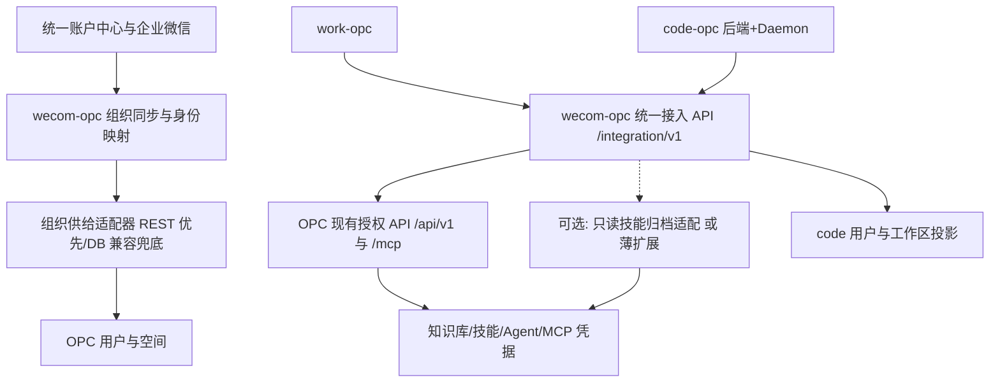

# OPC 统一云端 + 双客户端 + 组织集成 技术方案 v3（综合定稿）

> 日期：2026-10-19。版本：v3，综合 Kimi v2、Codex 版、Gemini 版三份方案，分歧点以源码/线上证据裁定。
> 状态：设计定稿，可用于实施拆解；未实施。线上信息为当日只读勘察快照。

## 1. 推荐决策（三份方案共识，保留）

**OPC-2.0 统一管理企业资源，wecom-opc 承担组织/身份/接入适配，work-opc 与 code-opc 保留各自执行引擎。**

- **work-opc**（OpenWorker fork）：办公场景客户端，本地文件、办公任务、交互审批。
- **code-opc**（Multica fork）：代码场景客户端，保留任务看板、Git、自有 Go 后端与 Daemon。
- **OPC-2.0**（WeKnora fork）：知识库、技能目录、云端 Agent、MCP 服务与凭据、用户与空间权限的管理中枢。**fork 内零源码改动**。
- **wecom-opc**（生产即 `weknora-gateway`，3002 端口）：企微/统一账户中心组织同步、登录桥、母空间广播，扩展为双客户端统一接入网关。

管理员只在 OPC 配置知识、技能、MCP、空间权限；客户端看到授权后的投影；网关不再建一套可独立修改这些资源的管理后台。

**实施原则：OPC 零源码改动优先，先验证接口能力，再决定扩展方式。** 薄扩展（第 8 节）是候选而非前提。

## 2. 勘察基线（以 Codex 修正版为准）

| 项目 | 基线 | 关键事实 |
| --- | --- | --- |
| work-opc | OpenWorker 0.3.4 | Python Agent/FastAPI；本地技能 folder-is-truth；MCP 客户端支持 streamable-http + headers + OAuth |
| code-opc | `2f247cc92f0c` | Multica fork；Electron + Go 后端 + PG + Daemon；workspace MCP 登记、skill 导入管线、PAT 体系 |
| OPC-2.0 | `58b14903` v0.8.3（服务器 HEAD `5f161cfa`） | 租户 RBAC、RAG、技能 catalog、内置 MCP server、Dex OIDC |
| wecom-opc | 本地无 git | 组织同步 + 企微登录 + 母空间广播；GORM 直写 OPC 库 + 共享 JWT_SECRET 自签 token |

服务器修正事实：运行 compose 在 **`/data/OPC-2.0/`**（不再是旧记录里的 `/data/WeKnora`）；gateway 独立 compose 在 `/data/weknora-tokendance`；公网 `admin.tokendance.sh` 只代理 `/api/ /mcp/ /files /r/`，**`/wecom/` 无公网入口**。镜像 ID 与源码 SHA 不能互替，"5.3.1" 是 jwt 库依赖版本的误读，不能标记网关发布版本。

**v3 修正的两个错误结论：**
1. ~~"skills catalog API 使技能零侵入分发已解决"~~——实为：catalog 文件内容接口要求 Admin、大文本截断、部分二进制仅返回元数据，**不能**用预览接口无损重建完整包。分发路线需原型验证（第 6.3 节）。
2. ~~"离职后客户端凭据天然失效"~~——MCP endpoint token 是独立机器主体，membership 撤销不影响它。个人授权必须走网关个人会话（第 5 节）。

## 3. 目标架构与数据所有权

| 数据/动作 | 权威来源 | 其他系统保留 |
| --- | --- | --- |
| 员工身份、部门、在职状态 | 统一账户中心（企微为登录与事件来源） | 网关存跨系统稳定 ID 映射 |
| OPC 用户、空间、有效角色 | OPC | 网关短时缓存；code 存受管投影 |
| 知识、索引、文档权限 | OPC | 客户端按需取片段，不复制向量库 |
| 企业技能、云端安装 | OPC | 已授权技能的版本化本地执行缓存 |
| MCP 定义、服务密钥、个人 OAuth | OPC | 客户端只持网关地址与受限运行授权 |
| 办公会话、代码任务、Git | 各客户端 | 网关只留外部 ID、授权与审计 |
| 本地执行审批 | 各客户端/Daemon | OPC 角色不自动授予本地文件/shell 权限 |

## 4. 四能力域最终方案

### 4.1 权限账号：企微身份 → 网关个人会话

- **客户端授权入口是网关个人会话，不是共享 endpoint token。** 原生客户端用系统浏览器 + PKCE + 一次性授权码登录，回环回调仅 `127.0.0.1`；refresh 进 OS Keychain/DPAPI。网关 access token 的 audience 与 OPC JWT、code JWT 各自独立。
- 网关侧用 **LegacyAuthAdapter** 收敛现有"共享 JWT_SECRET + 直写 auth_tokens"能力：token 留在网关加密存储、逐用户关联、按 OPC 当前状态校验、退出/停用回收。这是受控过渡件，配契约测试，密钥不出服务器。
- 身份键用不可变 `(issuer, external_subject) → opc_user_id` 唯一映射；**禁止 email 相同自动合并**（存量冲突单独处置）。
- code-opc 后端新增 federation exchange：一次性、指定 audience 的授权换 code 自有会话；其滑动 JWT 需增补企业 session ID/epoch 校验，覆盖 HTTP/WS/PAT/Daemon，否则撤权后旧 token 长期有效。
- Daemon 注册凭据只证明"哪台执行器"：每次任务领取由 code 后端向网关申请绑定 `user/tenant/workspace/task/device` 的**运行授权（租约）**，任务结束即撤。
- 撤权目标：网关应用变更后 **60 秒内**停止新云调用与续租；写操作执行前强制刷新授权；服务不可达时写动作失败关闭。

### 4.2 知识库：个人身份代理，区分预览与下载

- 统一暴露 `knowledge.search` / `knowledge.read` 两类工具，网关以**该用户在所选空间的身份**代理 `/api/v1/knowledge-search`、`/knowledge-bases/:id/hybrid-search` 等，不用全局管理员 key。
- 结果标准化（knowledge_id、chunk_id、标题、片段、引用定位、来源空间）；KB/文档 ID 由服务端再授权，不信任客户端传入。
- **预览 ≠ 下载**：OPC 下载路由权限高于 Viewer，`knowledge.read` 优先预览/片段接口，不以服务端转发绕过。
- 试点期（P1）允许受控直连：空间级 MCP endpoint 仅挂在网关/受控配置中，验收必须含"撤权后旧凭据不可用"。

### 4.3 技能：catalog 为管理源，发布与分发分离

- OPC 技能 catalog 仍是唯一管理源；**母空间广播机制保留**，但技能作为独立发布任务建模：源 catalog ID/版本/哈希 → 目标空间 → 幂等映射 → 下架策略；不默认向所有沙箱安装所有技能。
- **发布元数据**（manifest，如 `opc-client.json` 随包保存）：稳定技能 ID、版本、内容 SHA-256（服务端按实际字节计算）、执行模式（cloud_agent / local_instruction / local_sandbox）、适用客户端、允许工具类别。未声明或无法验证时默认只能云执行。
- **分发契约**：版本不可变、按固定版本下载、校验大小/文件数/路径/哈希、防 ZIP 越界与符号链接逃逸、原子安装到账号+空间隔离的受管缓存；命名 `opc/<tenant>/<skill-id>`，禁止个人同名技能静默遮蔽企业技能。
- **完整包获取三路线（原型 B 验证后选定）：**
  1. 若实际部署存在原生完整归档 API——验证字节完整性/角色/版本后优先复用（当前未证实）；
  2. 网关只读归档适配——受限存储访问，核对 catalog/安装快照与 SHA，承担 schema 契约维护；
  3. OPC 薄导出接口（第 8 节）——窄范围源码扩展，优先贡献上游。
  三条路线对客户端输出同一分发契约；都不可行时关闭本地分发、保留云委托，**不用管理员 token 补洞**。
- 消费端：work-opc 用 `agent.py` 的 `extra_skill_dirs`/`skill_filter` 注入受管技能（个人技能保留但分模式）；code-opc 在 `ResolveTaskSkillBundles` 入口加 OPC resolver，不另建全局同步程序。

### 4.4 MCP：双向分清，精确调用是可选扩展

- **入站**（客户端 → OPC 知识端点 `/mcp/<endpoint_id>`）：试点期直连；生产期收敛到网关统一企业连接 `opc-cloud`，工具列表按用户/空间/执行档案下发。
- **云委托**：优先用户身份的 `/sessions` + `/agent-chat/:session_id`（衔接个人权限与审批）；原生 `ask + default_agent_id` 仅用于端点级共享问答——它是端点主体，**不承诺**个人 OAuth/会话隔离。
- **出站精确调用**（客户端逐工具调 OPC 配置的外部 MCP）：无公开 API，候选薄扩展 `POST /api/v1/integration/mcp/invocations`（第 8 节）；原型通过前 `mcp_exact_call` 保持关闭。**不在网关复制凭据解密/OAuth 刷新实现。**
- 云端 stdio MCP 在服务器执行，不下发 command/env 到员工电脑。
- 审批/OAuth/取消统一状态机：`running/waiting_approval/waiting_oauth/succeeded/failed/cancelled/unknown_outcome`；写工具超时不自动重试，记录幂等键，结果未知可见。

## 5. wecom-opc 改造（合并 Codex 细则）

**P0 安全基线（公网开放硬前置）：** 入 git（排除 `config.yaml`/密钥/产物，记录线上二进制校验值与源码对应关系）；`/admin/**`、`/wecom/sync` 加服务内鉴权（全局操作需系统管理员，部门 Admin 仅本空间）+ CSRF/来源校验 + 审计；密钥改注入（OpenBao 可用性未验证前不作唯一依赖）；恢复 TLS 校验；最小契约测试起步。

**P1 组织治理闭环：**
- 事件回调实现"验签/解密 → 持久化并及时应答 → 查统一账户中心 → 生成差异 → 幂等执行"；**企微事件只是通知，不能凭企微侧缺失判定离职**；
- 全量同步改为"完整分页快照 → 完整性校验 → diff → 执行 → 记录"，异常/空快照**不触发批量清权**；部门级失败记为部分失败；
- 反向对账：调岗先算差异再增新收旧（保留有来源的手工授权）、主管降权回收托管 Admin、离职/停用撤销会话与运行授权并处理既有 token；
- `sync_run` 持久化（快照、差异、步骤、重试、告警），任务锁防 cron/事件/人工并发覆盖。

**P2 架构防腐：** store 抽接口、REST 优先 DB 兜底；映射规则配置化（20000+deptID、层级筛选、邮箱域名、角色映射——先固化再预演迁移）；清理死代码与假 `/oidc/*`；每条保留的 schema/token 依赖有契约测试与版本声明，**OPC 升级后兼容失败阻断写操作而非仅报警**。

**公网入口：** 推荐 cloudflared 新增 `gw.tokendance.sh → localhost:3002`（不碰 fork 部署物）；Phase 0 验收通过前不得开放。

## 6. 客户端改造落点

**work-opc：**
- `SessionManager` 全局单例（SecretStore/MCPManager/SkillStore）改显式依赖注入，隔离键 = `gateway_origin + opc_user_id + tenant_id`（任务连接再加 run_id）；切空间销毁旧 runtime/连接，杜绝串号；
- 企业 refresh token 进系统 Keychain/DPAPI，**不写 0600 JSON、不进会话日志与工具参数**；
- `agent.py build_engine` 用 `extra_tools`/`extra_skill_dirs` 注入云能力；保留本地 PermissionEngine/沙箱——有效权限 = 云授权 ∩ 受管策略 ∩ 本机许可。

**code-opc：**
- 保留自有 Go 后端 + DB，桌面端指向 code 后端而非 OPC API；
- **`mcp_config` 陷阱**：`null` = 继承本机全部 MCP，`{}` = 受管空配置；企业配置拉取失败必须传 `{}`，严禁回退 `null`；
- 逐 CLI 验收执行参数：Claude 的 `--permission-mode bypassPermissions` 等不能默认放开，云工具审批独立于本机权限模式；
- 企业能力（登录/资源选择/云审批 UI）按 `views → core + ui` 边界落，不指望纯 UI 插件覆盖登录与撤权。

## 7. 部署与升级契约

- OPC 维持现有部署；wecom-opc 出**版本化镜像**（不再裸挂二进制）；新增 code-opc 后端 + 独立库；compose overlay/入口/备份放独立集成部署目录，不改上游主 compose。
- 每次 OPC 升级记录：源码 SHA、补丁版本、镜像 digest、配置与迁移版本、通过的契约测试集；健康检查分存活/依赖可达/契约兼容三档。
- 发布流程：固定测试镜像 → 副本库验证迁移 → 两类角色/两空间契约测试 → 单部门灰度 → 扩大；回退靠功能开关（P3 出问题退回 P2 云委托，不自动降级为管理员绕行）。

## 8. OPC 薄扩展候选边界（非首期前提）

仅在原型证明现有 API 不足时实施，每项独立决策：技能运行包导出（`GET /api/v1/integration/skills/:catalog_id/bundle`，复用现有认证与存储，不开放目录遍历/MinIO 凭据）、MCP 精确调用（见 4.4）。组织供给 API、按 subject 绑定的 OIDC 是另两项独立演进能力。优先向上游提交通用能力；薄不薄以实际依赖数与契约测试衡量。

## 9. 路线图（双轨制）

**试点轨（天级，验证主干）：** Phase 0 安全基线（约 1 周，含 git/鉴权/TLS/密钥/契约测试起步）→ Phase 1 知识零代码对接（数天：试点空间 endpoint、work 配 mcp.json、code 登记 workspace MCP、端到端检索验证）。

**生产轨（周级，原型门禁驱动，估算非承诺）：**
- 三个原型先行：**A** 个人身份与撤权穿透双端（首个业务版本前置）；**B** 技能归档按权限无损分发；**C** 云委托的身份/审批/取消闭环。失败项保持能力关闭。
- P1 双端身份+空间+RAG（2–3 周）→ P2 组织闭环+云委托（1–2 周）→ P3a 本地技能 / P3b 精确 MCP（合计 2–4 周，原型后重估，可独立后置）→ P4 灰度与升级演练（1–2 周）。**全量约 7–12 周**，两名后端+一名客户端并行为前提。
- 首个纵向用例：同一员工 work 检索部门文档得正确引用 → code 在对应工作区用同一知识源跑任务 → 移除该员工权限后，两端及已领取任务均不得继续访问。

## 10. 验收矩阵（合并精简）

跨空间 ID 注入服务端拒绝；同名/改邮箱不串号；调岗/降权/离职正确回收且异常快照不误删；撤权覆盖 OPC token/网关会话/code PAT/WS/Daemon 续租及历史共享 endpoint token；技能包哈希匹配、防路径越界、同名不遮蔽；ask 端点主体语义如实呈现；MCP 写超时不重复副作用；work 切空间不串缓存与连接；code 企业 MCP 失败不继承本机；Viewer 无隐含写权限；审批/OAuth/取消可恢复且执行 token 不能自审批；OPC 升级兼容失败阻断而非静默回退高权限；日志/追踪不含凭据。

## 11. 实施前待验证清单

线上二进制与源码对应关系、网关公网访问控制现状；存量账号映射冲突与手工授权盘点；OPC 共享 Agent/技能安装快照/存储读取/MCP 审批上下文的契约可复用性；技能包获取路线的最小存储权限与完整性；统一账户中心的停用状态/完整快照能力；OpenBao 可用性；首批支持的操作系统/CLI/本地技能依赖组合。

---

### 附：三份来源方案的取舍说明

- **Codex 版**：证据边界与验收矩阵最严，v3 采用了其身份模型、撤权语义、技能分发三路线、双轨工期、验收矩阵主体与全部事实修正。
- **Gemini 版**：架构图与分阶段表达清晰，v3 保留了四层模型表达与 Phase 划分骨架；剔除其两处过度断言（技能零侵入已解决、凭据天然失效）。
- **Kimi v2**：保留了母空间广播复用为技能发布通道、`ask` 间接复用 OPC 侧 MCP 服务的思路（但按 Codex 修正标明主体语义），以及 nginx skills 路由的一线发现（降级为"待验证线索"）。
